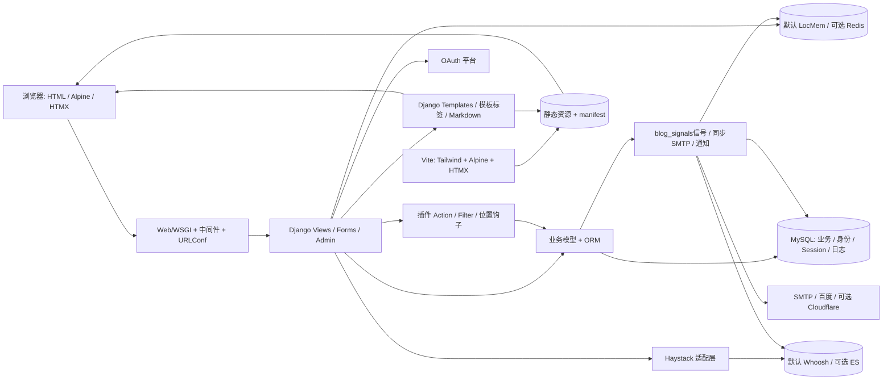
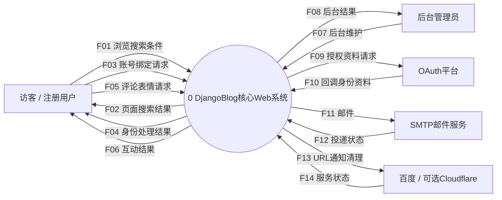
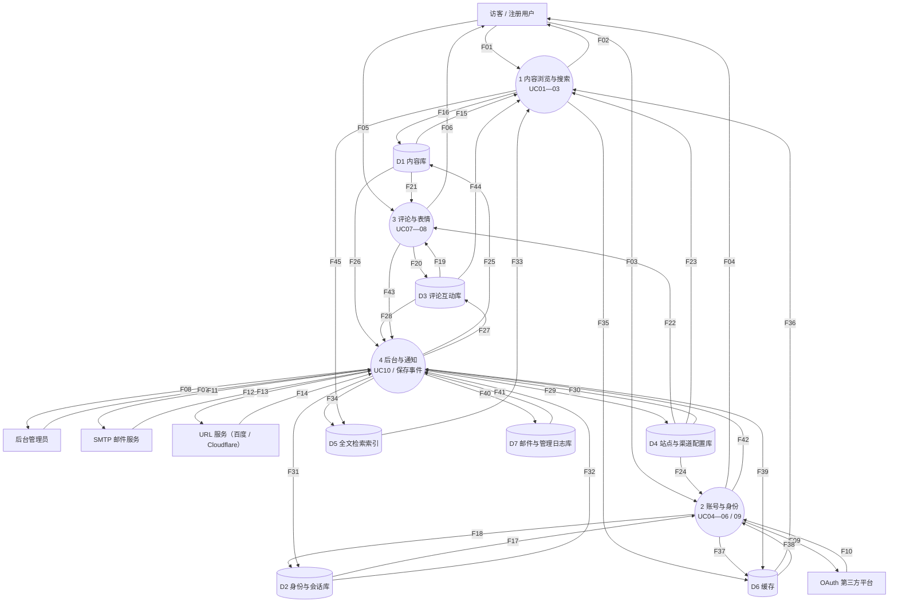

# 第六周：DjangoBlog 架构与数据字典

版本日期：2026-10-19。分析对象：`src/DjangoBlog` 当前工作区源码。本文件对应第六周“整体架构、系统数据流、主要数据条目的数据字典”任务，配套机器可读文件为 `architecture.json`。

本次采用静态源码阅读和 Python AST 提取模型字段，未启动 Django、未连接业务数据库或 Redis/Elasticsearch、未读取 `.env`、未调用 OAuth、SMTP 或外部推送服务。源码配置代表可用选项，不代表已经在本机启用；数据库物理结构和迁移应用状态仍需在隔离验收环境另行验证。

## 1. 分析范围与建模口径

核心范围为 UC01 浏览列表（含分类/作者/标签/归档/分页）、UC02 文章详情、UC03 搜索、UC04 注册激活、UC05 登录退出、UC06 找回密码、UC07 评论回复、UC08 表情互动、UC09 OAuth 与邮箱绑定、UC10 后台内容与配置。

已有 RSS/sitemap、健康检查、媒体上传及微信 `/robot` 入口在整体模块分析中保留说明，未扩充为本次核心 DFD 的外部流。本范围选择确保上下文图与第1层图边界一致，避免在分解层突然增加外部交互。

图中矩形实体代表系统外角色或服务，处理过程表示逻辑功能，数据存储表示系统管理的数据。P4“后台与通知”汇聚后台 CRUD 和保存事件处理，是逻辑过程划分；实际代码仍在同一 Django 项目进程中运行。E5“URL 服务”合并展示百度 URL 推送与可选 Cloudflare 清理两个独立运维服务，两者没有互相调用关系。检索索引和缓存由系统管理，所以在 DFD 中作为存储，实际部署可在本地或独立服务中。

数据字典符号：`+` 为组成，`|` 为择一，`[]` 为可选，`{}*` 为重复。F 为数据流，S 为结构，DE 为数据元素，D 为数据存储；边上的 F 编号可在字典中找到完整名称及结构。

## 2. 整体架构结论

系统采用 Django MVT 单体：浏览器请求经 WSGI、中间件、URLConf 分派到 View，View 调用 Form/ORM 和业务函数，Template 渲染 HTML。Django Admin 复用同一模型和身份系统。前端使用 Vite 打包 Tailwind、Alpine.js、HTMX；`frontend/src/main.js` 启动 Alpine 并注册评论、表情、账号过渡等组件，HTMX增强导航和局部更新。Vite 的角色是构建资源，不是独立业务 API 服务，也没有证据表明系统使用 SPA 或微服务。

基础持久化由 MySQL 完成，配置要求 `utf8mb4`，业务模型、身份、默认数据库 Session 和日志均由 ORM 管理。默认全文检索为中文 Whoosh；配置 `DJANGO_ELASTICSEARCH_HOST` 后切换自定义 Elasticsearch 后端。默认缓存为 LocMemCache；配置 `DJANGO_REDIS_URL` 后替换为 RedisCache。缓存与检索索引均为派生数据，不能替代数据库主数据。

账号支持本地注册激活、用户名或邮箱口令登录、退出和邮箱验证码找回密码，以及五类 OAuth 渠道。认证依据 Django Session；额外的 `logged_user=true` cookie 用于前端展示，不能据此授权。当前 `/admin` 入口由自定义 `DjangoBlogAdminSite.has_permission()` 仅检查 `request.user.is_superuser`；具体操作仍由 ModelAdmin 的权限与表单逻辑控制，不能套用 Django 默认的 staff/active 入口判断（`djangoblog/admin_site.py:18-26`）。请求链包含 CSRF 中间件，安全表单基类进一步统一敏感参数保护和禁用缓存行为。

插件在 AppConfig.ready 中动态导入配置目录中的 `plugin` 实例。BasePlugin 构造时执行初始化与注册钩子，Action/Filter/位置组件连接模板和 View；当前配置列出版权、阅读时长、外链、浏览量、SEO、图片懒加载、相关文章和 Cloudflare 缓存八项插件。Cloudflare 插件凭据缺失时自行停用，不构成基础浏览的必选依赖。

邮件调用链为 `djangoblog.utils.send_email()` → `blog_signals.send_email_signal_handler()` → 同步调用 SMTP → 写入 `servermanager.EmailSendLog`；servermanager 在此链中提供日志模型。公开评论的 post_save 回调另起 `_thread` 调用评论邮件辅助函数，邮件仍经同一 signal/SMTP 发送链。没有证据表明其使用 Celery、消息队列或持久重试。保存信号还负责精细缓存清理和百度 URL 通知；Cloudflare 插件独立监听 Article/Comment 的 post_save。普通保存清缓存与仅更新浏览量有分支，不能把所有模型变更都概括成一致的通知保证。

### 2.1 模块职责与源码证据

| 模块 | 职责 | 核心源码 / 位置 |
| --- | --- | --- |
| 请求入口与安全链 | WSGI→安全/Session/CSRF/认证等中间件→项目URLConf→应用View；复用安全表单基类；自定义/admin入口仅检查is_superuser，具体操作仍由ModelAdmin处理。 | djangoblog/wsgi.py；djangoblog/urls.py；djangoblog/settings.py；djangoblog/base_views.py；djangoblog/admin_site.py；settings.py:68-106；urls.py:57-77；admin_site.py:18-26 |
| blog 内容域 | 文章、分类树、标签、归档、详情、友情链接、站点设置、后台内容；OnlineMiddleware记录渲染耗时，ES启用时写performance。 | blog/models.py；blog/views.py；blog/urls.py；blog/admin.py；blog/middleware.py；models.py:64-410；views.py:35-356；middleware.py:17-53 |
| accounts 身份域 | 自定义BlogUser；用户名/邮箱口令登录、注册激活、退出、邮箱验证码重置密码；默认Django Session。 | accounts/models.py；accounts/forms.py；accounts/views.py；accounts/user_login_backend.py；accounts/utils.py；views.py:29-227；forms.py:20-113；user_login_backend.py:5-26 |
| comments 互动域 | 评论/回复树、公开状态、表情切换与统计；公开评论触发通知和缓存清理。 | comments/models.py；comments/forms.py；comments/views.py；comments/utils.py；models.py:12-149；views.py:20-137；forms.py:12-20 |
| oauth 第三方身份域 | weibo/google/github/facebook/qq渠道适配；code换token/资料；按(type,openid)查绑定；有邮箱登录，无邮箱补绑。 | oauth/models.py；oauth/oauthmanager.py；oauth/views.py；models.py:12-73；views.py:50-266 |
| 模板与前端增强 | Django服务端HTML；Alpine局部状态、HTMX导航与请求、Tailwind样式；Vite编译至Django静态目录并生成manifest。 | templates/；blog/templatetags/vite_tags.py；frontend/src/main.js；frontend/vite.config.js；frontend/package.json；main.js:6-62；vite.config.js:5-12,82-105；vite_tags.py:28-61,90-135 |
| 检索适配与派生索引 | Haystack统一搜索；默认中文Whoosh，配置环境后使用ES；提供高亮/建议，文章保存由RealtimeSignalProcessor维护索引。 | blog/search_indexes.py；blog/documents.py；djangoblog/whoosh_cn_backend.py；djangoblog/elasticsearch_backend.py；settings.py:215-258；search_indexes.py:7-16；elasticsearch_backend.py:75-145,195-206 |
| 插件系统 | 启动导入ACTIVE_PLUGINS中的plugin实例，BasePlugin初始化/注册hooks；正文过滤、位置组件和Action Hook扩展版权、阅读时长、外链、浏览量、SEO、懒加载、推荐及CF清缓存。 | djangoblog/apps.py；djangoblog/plugin_manage/；plugins/；djangoblog/apps.py:7-11；loader.py:10-40；base_plugin.py:22-31；settings.py:456-467 |
| 信号、邮件和缓存 | utils.send_email→blog_signals.send_email_signal_handler同步调用SMTP并写servermanager.EmailSendLog；公开评论保存另起线程调用评论邮件辅助函数，邮件仍经同一发送链；保存信号触发缓存和百度URL通知；CF凭据缺失时停用。 | djangoblog/blog_signals.py；djangoblog/utils.py；djangoblog/spider_notify.py；plugins/cloudflare_cache/；blog_signals.py:26-51,68-116；utils.py:129-174；cloudflare_cache/plugin.py:66-81,181-212 |
| servermanager 扩展域 | 提供EmailSendLog/后台命令模型及/robot微信入口；EmailSendLog负责持久化发送结果，SMTP发送由djangoblog.blog_signals处理；机器人搜索/最新文章/管理员指令为已有扩展，本次10用例之外单独说明。 | servermanager/models.py；servermanager/urls.py；servermanager/robot.py；servermanager/api/；models.py:5-33；urls.py:9-10；robot.py:51-116 |

### 2.2 关键运行路径

1. 内容浏览：浏览器 GET → `djangoblog.urls` → blog 应用 URLConf → View/缓存混入 → ORM/缓存 → 模板 → HTML。详情页额外加载公开评论、分页和 SEO，通过 `ARTICLE_DETAIL_LOAD` 与 `after_article_body_get` 触发插件；浏览量插件调用 `Article.viewed()`。
2. 全文检索：`/search` → Haystack 搜索视图工厂 → `EsSearchView` 和 `ElasticSearchModelSearchForm` → SearchQuerySet → Whoosh/ES → SearchResult → 搜索模板。ES查询限制 `status='p', type='a'`；Whoosh批量建索引只明确限制已发布状态，两种路径的规则不能混为一谈。
3. 认证：登录 Form → `EmailOrUsernameModelBackend` 核对密码 → `auth.login` 写 Session → 302及cookie。注册先写 `is_active=False` 用户并发激活链接；重置邮箱验证码存缓存300秒，验证后用 Django 哈希更新密码。
4. 评论互动：登录评论 Form → 读取文章与配置 → 关联用户/文章/父评论 → Comment.save → 保存信号 → 清缓存与可选邮件。表情 GET 公开查询；POST核对登录、公开评论及枚举，`get_or_create`切换记录后返回汇总 JSON。
5. 第三方身份：OAuth入口302 → 第三方授权 → 回调以code换token/资料 → `(type,openid)`查绑定。资料含邮箱时关联或创建本地用户并登录；缺邮箱时暂存 OAuthUser，再发补绑邮件并确认。
6. 后台与通知：ModelAdmin保存/批处理 → 数据库；普通save可能触发核心信号、Haystack及CF插件。后台部分批处理使用 `QuerySet.update()`，不触发save/post_save，因此缓存/索引一致性需要单独测试。

### 2.3 架构图源

下图是逻辑层级架构。可选服务在节点中明确标注，箭头表示调用/数据关系，不表示所有数据都经过单一消息总线。

## 3. 系统数据流模型

### 3.1 外部实体

| 编号 | 实体 | 交互范围 |
| --- | --- | --- |
| E1 | 访客 / 注册用户 | 核心用例的浏览、搜索、账号、评论与表情请求和响应；身份由Session区分。 |
| E2 | 后台管理员 | UC10后台内容、评论审核、用户及配置维护；可与E1是同一个自然人，但角色不同。 |
| E3 | OAuth第三方平台 | 授权跳转、code回调、token及用户资料交互；五类渠道由配置决定。 |
| E4 | SMTP邮件服务 | 发送激活/重置/绑定/评论邮件；返回投递计数或异常。 |
| E5 | URL服务（百度 / Cloudflare） | 百度推送URL；CF按需清除CDN URL缓存；各自独立可选配置。 |

### 3.2 上下文数据流图

P0整体仅与五个外部实体交换F01—F14。用户与服务间浏览器转发的OAuth授权/回调，在逻辑DFD中作为平台与P0的数据交互，具体传输由用例顺序图表达。

### 3.3 第1层处理过程

| 过程 | 用例覆盖 | 职责与分解边界 |
| --- | --- | --- |
| P1 内容浏览与搜索 | UC01—03 | 读文章/目录/公开评论、检索索引及展示配置，输出HTML。写浏览量及可重建缓存；不承担账号建立。 |
| P2 账号与身份 | UC04—06、UC09 | 校验注册/登录/重置，处理OAuth/邮箱绑定，维护用户/绑定/Session/验证码，并生成身份邮件事件。 |
| P3 评论与表情 | UC07—08 | 读取文章及审核配置，保存评论/回复、切换表情，返回重定向或JSON；公开评论保存产生通知事件。 |
| P4 后台与通知 | UC10及各业务保存事件 | 后台CRUD/审核/配置，聚合索引更新、缓存清理、外部推送和邮件日志。它是逻辑建模聚合，不代表源码有名为P4的独立服务。 |

### 3.4 第1层图源

为便于阅读，核心图仅在边上展示F编号，完整名称、数据结构和约束见第4节。渲染时可将外部实体、四过程、七存储按层排列；`architecture.json` 已提供固定坐标。

### 3.5 层间平衡检查

F01—F14在上下文图和第1层逐项保持相同编号、外部实体、方向与S结构；第1层只将P0映射为P1—P4。F15—F45为分解后新增内部流，不越过既定外部边界。没有外部实体直接读写数据存储，也没有存储到存储的直接流。

| 外部流 | 上下文端点 | 第1层端点 | 结构 |
| --- | --- | --- | --- |
| F01 | E1 → P0 | E1 → P1 | S01 |
| F02 | P0 → E1 | P1 → E1 | S02 |
| F03 | E1 → P0 | E1 → P2 | S03 |
| F04 | P0 → E1 | P2 → E1 | S04 |
| F05 | E1 → P0 | E1 → P3 | S05 |
| F06 | P0 → E1 | P3 → E1 | S06 |
| F07 | E2 → P0 | E2 → P4 | S07 |
| F08 | P0 → E2 | P4 → E2 | S08 |
| F09 | P0 → E3 | P2 → E3 | S09 |
| F10 | E3 → P0 | E3 → P2 | S10 |
| F11 | P0 → E4 | P4 → E4 | S11 |
| F12 | E4 → P0 | E4 → P4 | S12 |
| F13 | P0 → E5 | P4 → E5 | S13 |
| F14 | E5 → P0 | E5 → P4 | S14 |

## 4. 数据字典

### 4.1 数据流字典

同一F编号的定义在图间不变。数据流是逻辑业务数据，不直接等同于HTTP数据包或SQL语句；具体边界和校验依源码说明。

| 编号 / 名称 | 来源 → 去向 | 结构 | 定义 / 约束 |
| --- | --- | --- | --- |
| F01 浏览与搜索条件 | E1 → P1 | S01 | GET：路径参数、q、page、comment_page、is_suggest。UC01—03。 |
| F02 页面与搜索结果 | P1 → E1 | S02 | HTML 页面、分页和结果；不存在资源为404。UC01—03。 |
| F03 账号与绑定请求 | E1 → P2 | S03 | 注册、激活、登录/退出、重置密码、OAuth入口和补绑邮箱请求。UC04—06/09。 |
| F04 身份处理结果 | P2 → E1 | S04 | 表单错误/结果HTML/302以及Session cookie；logged_user仅为UI标记。 |
| F05 评论与表情请求 | E1 → P3 | S05 | POST评论body/parent_comment_id，GET或POST表情，附CSRF及Session。UC07—08。 |
| F06 评论处理结果 | P3 → E1 | S06 | 评论锚点302、错误表单，或表情汇总JSON及401/400/404。 |
| F07 后台维护请求 | E2 → P4 | S07 | 后台查询、增删改、发布/草稿、评论审核、配置维护请求。UC10。 |
| F08 后台操作结果 | P4 → E2 | S08 | 后台列表/表单/错误/成功消息及日志视图；按后台权限控制。 |
| F09 授权与用户信息请求 | P2 → E3 | S09 | 逻辑聚合授权URL/浏览器302、服务端code换token和用户资料请求。 |
| F10 授权回调与身份资料 | E3 → P2 | S10 | 浏览器回传code/type，平台返回token/openid/nickname/email/picture/metadata。 |
| F11 邮件投递 | P4 → E4 | S11 | 收件人、标题、HTML正文：激活、重置验证码、绑定或评论通知。 |
| F12 投递返回状态 | E4 → P4 | S12 | SMTP发送计数或异常；用于EmailSendLog.send_result，非到达/已读回执。 |
| F13 URL 推送与缓存清理 | P4 → E5 | S13 | 百度通知URL文本；Cloudflare可选的URL清除请求，二者独立配置。 |
| F14 URL 服务返回状态 | E5 → P4 | S14 | HTTP响应文本/清除success、errors或异常；记录日志。 |
| F15 文章与目录数据 | D1 → P1 | S15 | 文章/分类/标签/友情链接/侧边栏及作者关联读取。 |
| F16 浏览量更新 | P1 → D1 | S16 | view_count插件article.viewed→views单字段UPDATE；非独立访问明细。 |
| F17 账号与绑定记录 | D2 → P2 | S17 | BlogUser、OAuthUser、会话读取；不向普通访客返回口令哈希/token。 |
| F18 身份状态写入 | P2 → D2 | S17 | 用户注册/激活/重置、OAuth绑定和Django Session写入。 |
| F19 评论与表情记录 | D3 → P3 | S18 | 评论公开状态、父评论和表情计数/用户摘要。 |
| F20 评论与表情变更 | P3 → D3 | S18 | 评论新增；表情按(comment,user,reaction_type)新增或删除。 |
| F21 被评论文章 | D1 → P3 | S15 | 按主键读取文章，检查comment_status；未将发布态保证扩展为既有实现。 |
| F22 评论审核配置 | D4 → P3 | S19 | comment_need_review决定新评论是否直接is_enable=True。 |
| F23 站点展示配置 | D4 → P1 | S19 | SEO、站点名、分页数量、配色和模板开放评论开关。 |
| F24 OAuth 渠道配置 | D4 → P2 | S20 | 渠道标识、回调地址、启用状态及服务端凭据（报告不含值）。 |
| F25 文章与目录维护 | P4 → D1 | S15 | 管理员通过ModelAdmin增删改文章、分类、标签、链接、侧边栏。 |
| F26 内容维护查询 | D1 → P4 | S15 | 后台内容列表/编辑记录。 |
| F27 评论审核维护 | P4 → D3 | S18 | 后台修改is_enable或删除评论。 |
| F28 评论维护查询 | D3 → P4 | S18 | 后台评论列表/编辑记录。 |
| F29 站点与渠道配置维护 | P4 → D4 | S21 | BlogSettings仅在无记录时允许后台新增，已有配置只能编辑且禁止删除（BlogSettingsAdmin）；OAuthConfig按ModelAdmin权限新增/修改/删除；两者模型clean参与表单校验。 |
| F30 配置维护查询 | D4 → P4 | S21 | 后台读取站点参数和OAuth渠道配置。 |
| F31 账号与绑定维护 | P4 → D2 | S17 | 后台用户与OAuth绑定维护，受后台权限控制。 |
| F32 账号维护查询 | D2 → P4 | S17 | 用户和第三方绑定后台查询。 |
| F33 索引命中与摘要 | D5 → P1 | S22 | Whoosh或Elasticsearch返回命中、得分、高亮/建议。 |
| F34 文章索引更新 | P4 → D5 | S23 | Haystack信号/管理命令派生文档；此为逻辑事件处理归类，不是独立任务队列。 |
| F35 页面与查询缓存写入 | P1 → D6 | S24 | 列表/分类树/模板片段/SEO等缓存key、值和TTL。 |
| F36 缓存命中数据 | D6 → P1 | S24 | 命中则复用，否则经ORM或索引查询并填充。 |
| F37 重置验证码写入 | P2 → D6 | S25 | 以email为key存验证码，TTL 300秒。 |
| F38 重置验证码读取 | D6 → P2 | S25 | 核对验证码；当前verify未在成功后删除缓存值。 |
| F39 缓存失效指令 | P4 → D6 | S26 | 模型保存、用户登录退出、配置保存等清理缓存；非持久业务真源。 |
| F40 邮件与管理日志写入 | P4 → D7 | S27 | EmailSendLog持久化收件人、标题、正文、发送结果；后台有LogEntry。 |
| F41 运行日志查询 | D7 → P4 | S27 | EmailSendLog等后台查询；仅授权后台可见。 |
| F42 身份邮件与保存事件 | P2 → P4 | S28 | 激活/重置/邮箱绑定邮件，以及符合get_full_url条件的保存通知事件。 |
| F43 公开评论保存事件 | P3 → P4 | S28 | post_save中is_enable=True时清缓存并起线程邮件；Cloudflare插件另行接收保存信号。 |
| F44 公开评论展示 | D3 → P1 | S18 | 文章详情查询顶层公开评论及子回复，并读取公开评论总数。 |
| F45 搜索查询 | P1 → D5 | S29 | Haystack查询词、分页偏移和是否启用建议/高亮。 |

### 4.2 数据结构字典

| 编号 / 名称 | 组成 | 说明 / 规则 |
| --- | --- | --- |
| S01 浏览搜索参数 | [year,month,day,article_id] + [category_name\|author_name\|tag_name] + [page] + [q] + [is_suggest] + [comment_page] | 路由分页page为整数；comment_page被钳制；q由Haystack表单处理；is_suggest=no表示不启用建议。 |
| S02 内容响应 | HTTP状态 + (HTML{文章列表/文章/评论/分页/SEO/表单} \| 重定向Location) | 服务端模板渲染；Alpine/HTMX只负责增强交互。 |
| S03 账号请求族 | Register{username,email,password1,password2} \| Activate{id,sign,type} \| Login{username,password,remember,next} \| Logout{} \| Reset{email,code,new_password1,new_password2} \| OAuthStart{type,next_url} \| Bind{email,oauthid} | 口令、验证码、签名只在请求/服务端处理，报告不记录样例值。 |
| S04 身份响应 | HTTP状态 + [Location] + [HTML表单/错误/提示] + [sessionid cookie] + [logged_user=true] | Session证明身份；logged_user是可由JS读取的界面标记，不能作为授权依据。 |
| S05 互动请求族 | Comment{article_id,body,[parent_comment_id]} \| Reaction{comment_id,[reaction_type]} + CSRF + Session | 表情GET不必登录；POST需要登录；CSRF由中间件处理。 |
| S06 互动响应 | Comment{302 Location#div-comment-id \| HTML错误} \| Reaction{success,[action],reactions} \| Error{error} | 表情认证失败401、类型不合法400、目标评论未公开/不存在404；成功action=added/removed。 |
| S07 后台请求 | admin路径 + 模型标识 + 操作(CRUD/批处理) + 模型字段 + Session + CSRF | 当前/admin入口由自定义DjangoBlogAdminSite.has_permission仅检查request.user.is_superuser；具体操作仍由ModelAdmin权限及表单处理，不套用默认staff/active入口判断。Article后台作者下拉限制superuser。 |
| S08 后台响应 | HTTP状态 + 后台HTML{列表\|变更表单\|权限错误\|成功消息} | 不把后台等同于对所有登录用户开放。 |
| S09 OAuth平台请求 | 授权URL{client_id,redirect_uri,...} \| token请求{code,渠道凭据,...} \| userinfo请求{token,...} | 各平台参数由OAuthManager子类适配。授权请求通过浏览器跳转，token/userinfo由服务端调用。 |
| S10 OAuth平台响应 | callback{type,code,[next_url]} + token响应 + userinfo{openid,nickname,[email],[picture],[metadata]} | 平台资料映射OAuthUser；邮箱缺失进入补绑分支。token只描述用途不输出值。 |
| S11 邮件消息 | emailto[1..n] + title + content(HTML) | 来自注册/重置/绑定/公开评论；正文可能含机密临时信息。 |
| S12 邮件状态 | send_count(整数) \| exception | send_result=(send_count>0)，表示SMTP提交成功与否，不保证最终送达。 |
| S13 URL服务请求 | Baidu{URLs以换行分隔} \| Cloudflare{files:[URL...]} | Baidu端点配置含敏感token；CF凭据由服务端附带，按不超过30URL分批。 |
| S14 URL服务结果 | HTTP响应文本 \| Cloudflare{success,errors} \| exception | 百度函数只记录响应文本；CF捕获异常/失败日志。 |
| S15 内容集合 | Article + Category + Tag + [ArticleTag] + [Links] + [SideBar] | 详细字段见实体数据字典；外键与中间表关系分别记录。 |
| S16 浏览量更新 | article_id + views | view_count插件调用Article.viewed；BaseModel对update_fields=[views]直接QuerySet.update。 |
| S17 身份集合 | BlogUser + [OAuthUser] + [Session] + [Group/Permission] | User.username数据库唯一；email仅注册表单去重；OAuthUser允许author为空。 |
| S18 互动集合 | Comment + [CommentReaction] + [ReactionSummary] | Comment.parent_comment自引用允许空；表情联合唯一。 |
| S19 站点展示配置 | site_name + site_description + site_seo_description + site_keywords + 各显示数量 + open_site_comment + comment_need_review + color_scheme + 公共HTML | 数据库保存BlogSettings。clean限制一行，但无数据库单例约束。 |
| S20 OAuth渠道配置 | type + appkey + appsecret + callback_url + is_enable | appkey/appsecret属于服务端敏感项，文档不含实际值。 |
| S21 配置集合 | BlogSettings + OAuthConfig + Site | Site存域名/站点名；当前后台配置与系统环境变量配置分开。 |
| S22 检索命中 | {article_id,score,[highlighted{title[],body[]}] }* + hits + [spelling_suggestion] | ES返回结构；Whoosh经Haystack统一为SearchResult。 |
| S23 索引文档 | article_id + title + body + [author/category/tags] + [pub_time/status/type/... ] | Whoosh ArticleIndex批量仅筛status=p；ES查询另筛status=p,type=a。实时索引不能直接等同于访问权限。 |
| S24 普通缓存项 | cache_key + value + [TTL秒] | 列表、模型派生、模板片段及SEO等；默认缓存超时10800秒，业务装饰器可覆盖。 |
| S25 重置验证码缓存 | email(key) + code(value) + TTL=300秒 | 与普通页面缓存同用Django缓存后端；默认LocMem跨进程不共享。 |
| S26 缓存失效操作 | key删除列表 \| template_fragment_key删除 \| cache.clear() | BlogSettings.save直接clear；各模型保存信号精细清理，不能宣称所有删除/批量更新都失效。 |
| S27 日志记录 | EmailSendLog{emailto,title,content,send_result,creation_time} \| LogEntry{user,content_type,object_id,action_flag,change_message,...} | 含邮件地址/正文，后台最小访问。SMTP失败仍保存send_result=False。 |
| S28 保存/邮件业务事件 | model_label + instance_id + [is_enable] + [update_fields] + [emailto,title,content] | 逻辑事件汇聚至P4；实际实现是当前Django进程的signals和回调，不是消息总线。 |
| S29 检索后端参数 | query_string + start_offset + end_offset + highlight + is_suggest | 搜索页传SearchQuerySet.highlight；自定义表单设置后端is_suggest。 |
| S30 文章记录 | id + title + body + pub_time + status + comment_status + type + views + author_id + article_order + show_toc + category_id + creation_time + last_modify_time + {tag_id}* | title唯一；作者、分类CASCADE；tags可空。 |
| S31 用户记录 | AbstractUser字段 + nickname + creation_time + last_modify_time + source | 继承密码哈希、username、email、is_active/is_staff/is_superuser和权限关系；密码哈希不公开。 |
| S32 评论记录 | id + body + creation_time + last_modify_time + author_id + article_id + [parent_comment_id] + is_enable | body在ModelForm最多300字符；is_enable无法区分待审与禁用。 |
| S33 表情记录 | id + comment_id + user_id + reaction_type + created_at | 同评论同用户同表情唯一，同一用户可对一条评论使用多种不同表情。 |
| S34 OAuth绑定记录 | id + [author_id] + openid + nickname + [token] + [picture] + type + [email] + [metadata] + creation_time + last_modify_time | 无(type,openid)数据库联合唯一；author可空；与本地账户非一对一。 |
| S35 表情汇总 | {emoji: {count,has_reacted,users:[显示名称]}} | 每表情最多返回10位用户显示名；count为总数，has_reacted针对请求用户。 |

### 4.3 主要数据元素字典

| 编号 / 字段 | 类型 / 长度 | 范围、默认值、规则及敏感性 |
| --- | --- | --- |
| DE01 id / *_id | 整数主键或外键 | BaseModel显式AutoField；其它业务模型默认BigAutoField（以当前源码settings为准，迁移历史应另核）。FK必须引用目标模型，CASCADE是Django删除收集策略。 |
| DE02 Article.title | CharField(200) | 非空，unique=True；标题同时参与显示/搜索。 |
| DE03 Article.body | MDTextField | Markdown正文；模型未声明正文长度上限，渲染由Markdown和清理工具处理。 |
| DE04 Article.status | CharField(1) | d=草稿，p=发布；默认p；choices不是枚举数据库CHECK。 |
| DE05 Article.comment_status | CharField(1) | o=开放，c=关闭；默认o。 |
| DE06 Article.type | CharField(1) | a=文章，p=独立页面；默认a。 |
| DE07 Article.views | PositiveIntegerField | 默认0；浏览量计数，非去重访客数，源码read-increment-write有并发丢增可能。 |
| DE08 Article.author / category | 非空ForeignKey | 均on_delete=CASCADE；标签为可空ManyToMany，不是逗号文本。 |
| DE09 pub_time / creation_time / last_modify_time | DateTimeField | pub_time/多数时间默认now；last_modify_time通常不自动刷新。 |
| DE10 Category.name / Tag.name | CharField(30) | 分别唯一；slug为SlugField(60)，blank=True，非unique。 |
| DE11 Category.parent_category | 可空self ForeignKey | 根分类为空，CASCADE；未见防分类环的模型clean约束。 |
| DE12 BlogUser.username | CharField(150) | 继承AbstractUser，数据库唯一，有用户名validator；迁移声明可核对。 |
| DE13 BlogUser.email | EmailField(254) | 继承字段blank=True、非unique；RegisterForm.clean_email去重，不能替代并发DB唯一。 |
| DE14 BlogUser.password | CharField(128) | Django密码哈希存储；原始口令不落入报告，普通公开响应不可携带。 |
| DE15 nickname / source | CharField(100) | 可blank；nickname为展示名，source记录Register/authorize/emailconfirm等来源。 |
| DE16 is_active / is_staff / is_superuser | Boolean | 继承的身份标志默认active=True、staff=False、superuser=False，注册视图主动active=False；当前自定义/admin入口仅检查is_superuser，具体操作仍由ModelAdmin控制，不能套用默认staff/active入口判断。 |
| DE17 Comment.body | TextField(max_length=300) | ModelForm校验最多300字符，非MySQL TEXT物理300字符约束。 |
| DE18 Comment.parent_comment | 可空self ForeignKey | CASCADE；数据库不保证父子同文章。 |
| DE19 Comment.is_enable | Boolean | 默认False；True代表公开，免审核也直接True，不能单独表示人工已审。 |
| DE20 CommentReaction.reaction_type | CharField(10) | 枚举👍/👎/❤️/😄/🎉/😕/🚀/👀；POST视图显式校验。 |
| DE21 CommentReaction.(comment,user,reaction_type) | 联合唯一键 | 数据库unique_together；同用户可以对同评论给多种不同表情。 |
| DE22 ReactionSummary.count/has_reacted/users | 整数/布尔/显示名数组 | count是总人数，users最多10个，has_reacted按当前请求用户计算。 |
| DE23 OAuthUser.openid / type / nickname | CharField(50) | 无(type,openid)联合唯一；type为渠道标识；nickname非空。 |
| DE24 OAuthUser.author | 可空ForeignKey | CASCADE；未绑本地账号时可为空，并非OneToOne。 |
| DE25 OAuthUser.token | CharField(150),可空/可blank | 第三方访问凭据；Facebook回调将该字段设空；只描述不输出值。 |
| DE26 OAuthUser.picture / email / metadata | CharField(350)/CharField(50)/TextField | 可空/可blank；metadata为原始资料文本，email不是EmailField，需保留类型差异。 |
| DE27 OAuthConfig.type | CharField(10) | 支持weibo/google/github/facebook/qq；源码默认a不在choices内；clean限制同渠道，无数据库unique。 |
| DE28 OAuthConfig.appkey / appsecret | CharField(200) | 渠道认证配置，服务端敏感数据；文档不输出实际值。 |
| DE29 OAuthConfig.callback_url / is_enable | CharField(200)/Boolean | callback_url非blank默认空字符串；is_enable默认True。 |
| DE30 BlogSettings.color_scheme | CharField(20) | purple/blue/green/orange/pink/red/indigo/teal，默认purple；选择校验属应用层。 |
| DE31 BlogSettings.open_site_comment / comment_need_review | Boolean | 默认True/False；入口控制与服务端校验需区分。 |
| DE32 BlogSettings各显示数量 | IntegerField | article_sub_length=300，sidebar_article_count=10，sidebar_comment_count=5，article_comment_count=5；源码未声明正数模型约束。 |
| DE33 BlogSettings公共HTML/统计代码 | TextField | global_header/global_footer/analytics_code/广告代码等；应仅管理员可信配置，不在报告重现脚本内容。 |
| DE34 q / is_suggest / page | 字符串/开关/分页值 | q为Haystack查询词；is_suggest仅等于no时禁用建议；页数由路由/搜索分页解析，comment_page单独钳制。 |
| DE35 parent_comment_id | 可选IntegerField | 来自表单隐藏字段；类型校验不代表父评论存在或同文章。 |
| DE36 remember / next / next_url | 布尔意图/相对或同域URL | remember按POST值存在性判断；登录next做allowed-host校验，OAuth next_url做同域/相对URL校验。 |
| DE37 code / sign | 敏感临时字符串 | 重置code缓存5分钟；激活/绑定sign由SECRET_KEY与ID派生，当前链接签名未带显式到期时间。 |
| DE38 sessionid / logged_user | cookie | sessionid用于Django会话；logged_user=true仅前端状态提示，httponly=False，不承担认证。 |
| DE39 EmailSendLog.send_result | Boolean | 默认False；SMTP send计数>0写True，异常写False。 |
| DE40 EmailSendLog.emailto/title/content | CharField(300)/CharField(2000)/TextField | emailto存逗号拼接收件人；content保留正文，含个人与临时敏感数据。 |
| DE41 Links.name / link / sequence | CharField(30)/URLField/IntegerField | name唯一，sequence唯一；show_type为i/l/p/a/s；默认i。 |
| DE42 SideBar.name / content / sequence | CharField(100)/TextField/IntegerField | sequence唯一，is_enable默认True。 |
| DE43 article_order / show_toc | IntegerField/BooleanField | 默认0/False；文章排序为-article_order,-pub_time。 |
| DE44 HTTP success / action / error | 布尔/枚举/字符串 | 表情成功success=True；action=added/removed；无效类型响应仅error，不强行假设统一错误schema。 |

### 4.4 数据存储字典

| 编号 / 存储 | 包含模型 / 介质 | 用途 | 主键 / 重要约束 |
| --- | --- | --- | --- |
| D1 内容库 | blog.Article；blog.Category；blog.Tag；blog.Links；blog.SideBar；blog_article_tags | MySQL业务主数据；Article标签通过中间表关联。 | 各模型主键；Article.title、Category.name、Tag.name、Links.name/sequence、SideBar.sequence唯一 |
| D2 身份与会话库 | accounts.BlogUser；oauth.OAuthUser；django_session；用户组/权限中间表 | MySQL用户、OAuth绑定、默认数据库Session。 | 用户主键；username唯一；email和(type,openid)无数据库唯一约束 |
| D3 评论互动库 | comments.Comment；comments.CommentReaction | MySQL评论树和独立表情记录。 | 评论主键；表情(comment,user,reaction_type)联合唯一 |
| D4 站点与渠道配置库 | blog.BlogSettings；oauth.OAuthConfig；django_site | 站点展示/审核参数、渠道配置和Site域名；凭据仅在服务端读取。 | 模型主键；单例/渠道唯一只由clean校验 |
| D5 全文检索索引 | Whoosh whoosh_index；Elasticsearch blog (启用时) | 由文章派生；默认Whoosh，配置ES后切换后端。索引不是业务真源。 | 文章主键映射索引文档id |
| D6 缓存 | Django LocMemCache；可选 RedisCache | 默认进程内缓存，配置Redis时替换；保存查询/片段和5分钟验证码。 | 业务key/邮箱key及TTL；缓存丢失可重建派生项，验证码需重发 |
| D7 邮件与管理日志库 | servermanager.EmailSendLog；django_admin_log | MySQL发送记录与后台审计；正文可能含激活链接/验证码，不公开展示。 | 自增主键，EmailSendLog按creation_time倒序 |

## 5. 主要模型字段及关系核对

本节字段从当前 `models.py` 的 AST 提取，没有导入 Django。模型字段选项是源码声明，不能据此断言现有数据库已经应用对应迁移。`null` 未显式声明时默认为False；`blank` 是表单/模型校验空值规则，与数据库NULL不同；未列出的默认值表示该字段未显式设置default。

`BaseModel` 是抽象父类，向 Article、Category、Tag 继承 `id/creation_time/last_modify_time`，不会单独生成BaseModel表。其它模型使用当前默认主键设置BigAutoField。BlogUser继承AbstractUser，除源码自定义字段外，还包含 `id/password/last_login/username/first_name/last_name/email/is_staff/is_active/is_superuser/date_joined` 及 groups/user_permissions 多对多关系，迁移 `accounts/0001_initial.py:21-37` 可核对继承字段。其中 username唯一，email非唯一。

关系要点：用户1:N文章、用户1:N评论、文章1:N评论、分类1:N文章、文章N:M标签；分类和评论都有允许空的父节点自关联；评论1:N表情、用户1:N表情，表情三元组唯一；OAuthUser通过允许空的author外键关联BlogUser，非OneToOne。所有这些业务外键均声明Django CASCADE删除行为，不把它混同为数据库端原生ON DELETE语句的保证。

### blog.BaseModel

源码：`src/DjangoBlog/blog/models.py:30`。基类：`models.Model`。

| 字段 | 类型 / 长度 | 声明选项 | 行 |
| --- | --- | --- | --- |
| id | AutoField | primary_key=True | 31 |
| creation_time | DateTimeField | default=now | 32 |
| last_modify_time | DateTimeField | default=now | 33 |

### blog.Article

源码：`src/DjangoBlog/blog/models.py:64`。基类：`BaseModel`。

| 字段 | 类型 / 长度 | 声明选项 | 行 |
| --- | --- | --- | --- |
| title | CharField(200) | unique=True | 78 |
| pub_time | DateTimeField | null=False；blank=False；default=now | 80 |
| status | CharField(1) | default='p'；choices=STATUS_CHOICES | 82 |
| comment_status | CharField(1) | default='o'；choices=COMMENT_STATUS | 87 |
| type | CharField(1) | default='a'；choices=TYPE | 92 |
| views | PositiveIntegerField | default=0 | 93 |
| author | ForeignKey | 关联 settings.AUTH_USER_MODEL；null=False；blank=False；on_delete=models.CASCADE | 95 |
| article_order | IntegerField | null=False；blank=False；default=0 | 101 |
| show_toc | BooleanField | null=False；blank=False；default=False | 103 |
| category | ForeignKey | 关联 'Category'；null=False；blank=False；on_delete=models.CASCADE | 104 |
| tags | ManyToManyField | 关联 'Tag'；blank=True | 110 |

### blog.Category

源码：`src/DjangoBlog/blog/models.py:195`。基类：`BaseModel`。

| 字段 | 类型 / 长度 | 声明选项 | 行 |
| --- | --- | --- | --- |
| name | CharField(30) | unique=True | 197 |
| parent_category | ForeignKey | 关联 'self'；null=True；blank=True；on_delete=models.CASCADE | 199 |
| slug | SlugField(60) | blank=True；default='no-slug' | 205 |
| index | IntegerField | default=0 | 206 |

### blog.Tag

源码：`src/DjangoBlog/blog/models.py:259`。基类：`BaseModel`。

| 字段 | 类型 / 长度 | 声明选项 | 行 |
| --- | --- | --- | --- |
| name | CharField(30) | unique=True | 261 |
| slug | SlugField(60) | blank=True；default='no-slug' | 262 |

### blog.Links

源码：`src/DjangoBlog/blog/models.py:280`。基类：`models.Model`。

| 字段 | 类型 / 长度 | 声明选项 | 行 |
| --- | --- | --- | --- |
| name | CharField(30) | unique=True | 283 |
| link | URLField | 未显式声明额外选项 | 284 |
| sequence | IntegerField | unique=True | 285 |
| is_enable | BooleanField | null=False；blank=False；default=True | 286 |
| show_type | CharField(1) | default=LinkShowType.I；choices=LinkShowType.choices | 288 |
| creation_time | DateTimeField | default=now | 293 |
| last_mod_time | DateTimeField | default=now | 294 |

### blog.SideBar

源码：`src/DjangoBlog/blog/models.py:305`。基类：`models.Model`。

| 字段 | 类型 / 长度 | 声明选项 | 行 |
| --- | --- | --- | --- |
| name | CharField(100) | 未显式声明额外选项 | 307 |
| content | TextField | 未显式声明额外选项 | 308 |
| sequence | IntegerField | unique=True | 309 |
| is_enable | BooleanField | default=True | 310 |
| creation_time | DateTimeField | default=now | 311 |
| last_mod_time | DateTimeField | default=now | 312 |

### blog.BlogSettings

源码：`src/DjangoBlog/blog/models.py:323`。基类：`models.Model`。

| 字段 | 类型 / 长度 | 声明选项 | 行 |
| --- | --- | --- | --- |
| site_name | CharField(200) | null=False；blank=False；default='' | 337 |
| site_description | TextField(1000) | null=False；blank=False；default='' | 343 |
| site_seo_description | TextField(1000) | null=False；blank=False；default='' | 349 |
| site_keywords | TextField(1000) | null=False；blank=False；default='' | 351 |
| article_sub_length | IntegerField | default=300 | 357 |
| sidebar_article_count | IntegerField | default=10 | 358 |
| sidebar_comment_count | IntegerField | default=5 | 359 |
| article_comment_count | IntegerField | default=5 | 360 |
| show_google_adsense | BooleanField | default=False | 361 |
| google_adsense_codes | TextField(2000) | null=True；blank=True；default='' | 362 |
| open_site_comment | BooleanField | default=True | 364 |
| color_scheme | CharField(20) | default='purple'；choices=COLOR_SCHEMES | 365 |
| global_header | TextField | null=True；blank=True；default='' | 371 |
| global_footer | TextField | null=True；blank=True；default='' | 372 |
| beian_code | CharField(2000) | null=True；blank=True；default='' | 373 |
| analytics_code | TextField(1000) | null=False；blank=False；default='' | 379 |
| show_gongan_code | BooleanField | null=False；default=False | 385 |
| gongan_beiancode | TextField(2000) | null=True；blank=True；default='' | 387 |
| comment_need_review | BooleanField | null=False；default=False | 393 |

### accounts.BlogUser

源码：`src/DjangoBlog/accounts/models.py:12`。基类：`AbstractUser`。

| 字段 | 类型 / 长度 | 声明选项 | 行 |
| --- | --- | --- | --- |
| nickname | CharField(100) | blank=True | 13 |
| creation_time | DateTimeField | default=now | 14 |
| last_modify_time | DateTimeField | default=now | 15 |
| source | CharField(100) | blank=True | 16 |

### comments.Comment

源码：`src/DjangoBlog/comments/models.py:12`。基类：`models.Model`。

| 字段 | 类型 / 长度 | 声明选项 | 行 |
| --- | --- | --- | --- |
| body | TextField(300) | 未显式声明额外选项 | 15 |
| creation_time | DateTimeField | default=now | 17 |
| last_modify_time | DateTimeField | default=now | 20 |
| author | ForeignKey | 关联 settings.AUTH_USER_MODEL；on_delete=models.CASCADE | 22 |
| article | ForeignKey | 关联 Article；on_delete=models.CASCADE | 27 |
| parent_comment | ForeignKey | 关联 'self'；null=True；blank=True；on_delete=models.CASCADE | 33 |
| is_enable | BooleanField | null=False；blank=False；default=False | 41 |

### comments.CommentReaction

源码：`src/DjangoBlog/comments/models.py:101`。基类：`models.Model`。

| 字段 | 类型 / 长度 | 声明选项 | 行 |
| --- | --- | --- | --- |
| comment | ForeignKey | 关联 Comment；on_delete=models.CASCADE；related_name='reactions' | 117 |
| user | ForeignKey | 关联 settings.AUTH_USER_MODEL；on_delete=models.CASCADE | 124 |
| reaction_type | CharField(10) | choices=REACTION_CHOICES | 131 |
| created_at | DateTimeField | auto_now_add=True | 137 |

### oauth.OAuthUser

源码：`src/DjangoBlog/oauth/models.py:12`。基类：`models.Model`。

| 字段 | 类型 / 长度 | 声明选项 | 行 |
| --- | --- | --- | --- |
| author | ForeignKey | 关联 settings.AUTH_USER_MODEL；null=True；blank=True；on_delete=models.CASCADE | 13 |
| openid | CharField(50) | 未显式声明额外选项 | 19 |
| nickname | CharField(50) | 未显式声明额外选项 | 20 |
| token | CharField(150) | null=True；blank=True | 21 |
| picture | CharField(350) | null=True；blank=True | 22 |
| type | CharField(50) | null=False；blank=False | 23 |
| email | CharField(50) | null=True；blank=True | 24 |
| metadata | TextField | null=True；blank=True | 25 |
| creation_time | DateTimeField | default=now | 26 |
| last_modify_time | DateTimeField | default=now | 27 |

### oauth.OAuthConfig

源码：`src/DjangoBlog/oauth/models.py:41`。基类：`models.Model`。

| 字段 | 类型 / 长度 | 声明选项 | 行 |
| --- | --- | --- | --- |
| type | CharField(10) | default='a'；choices=TYPE | 49 |
| appkey | CharField(200) | 未显式声明额外选项 | 50 |
| appsecret | CharField(200) | 未显式声明额外选项 | 51 |
| callback_url | CharField(200) | blank=False；default='' | 52 |
| is_enable | BooleanField | null=False；blank=False；default=True | 57 |
| creation_time | DateTimeField | default=now | 59 |
| last_modify_time | DateTimeField | default=now | 60 |

### servermanager.commands

源码：`src/DjangoBlog/servermanager/models.py:5`。基类：`models.Model`。

| 字段 | 类型 / 长度 | 声明选项 | 行 |
| --- | --- | --- | --- |
| title | CharField(300) | 未显式声明额外选项 | 6 |
| command | CharField(2000) | 未显式声明额外选项 | 7 |
| describe | CharField(300) | 未显式声明额外选项 | 8 |
| creation_time | DateTimeField | auto_now_add=True | 9 |
| last_modify_time | DateTimeField | auto_now=True | 10 |

### servermanager.EmailSendLog

源码：`src/DjangoBlog/servermanager/models.py:20`。基类：`models.Model`。

| 字段 | 类型 / 长度 | 声明选项 | 行 |
| --- | --- | --- | --- |
| emailto | CharField(300) | 未显式声明额外选项 | 21 |
| title | CharField(2000) | 未显式声明额外选项 | 22 |
| content | TextField | 未显式声明额外选项 | 23 |
| send_result | BooleanField | default=False | 24 |
| creation_time | DateTimeField | auto_now_add=True | 25 |

### 5.1 数据库声明与应用校验边界

以下说明区分“数据库声明的约束”“Django ModelForm/clean的验证”和“当前没有实现的业务规则”，避免把要求写成已实现行为。

| 规则 | 源码现状 | 边界 |
| --- | --- | --- |
| 文章标题、分类/标签名唯一 | 相应字段unique=True | 数据库唯一声明；仍需隔离数据库核对迁移应用。 |
| 文章标签关系去重 | Django自动M2M中间表 | 关系由框架维护，非字符串列表。 |
| 同评论、同用户、同表情唯一 | CommentReaction.Meta.unique_together | 数据库联合唯一声明；多种不同表情允许同时存在。 |
| 评论长度300 | Comment.body TextField(max_length=300)，CommentForm ModelForm | 表单/模型验证，不是MySQL TEXT物理列300字符限制；save不自动full_clean。 |
| 枚举值合法性 | Article/OAuthConfig/CommentReaction字段choices | choices用于表单/模型校验；未声明枚举CheckConstraint，表情POST另显式检查。 |
| 站点设置只一行 | BlogSettings.clean执行查询 | 应用层检查；并发写入或绕过full_clean不保证单例。 |
| 站点配置后台增删 | BlogSettingsAdmin.has_add_permission / has_delete_permission | 仅无记录时允许新增；始终禁止删除；已有记录直接编辑。见blog/admin.py:113-128。 |
| OAuth渠道只一行 | OAuthConfig.clean按type检查全部记录 | 应用层检查，不限is_enable；type无数据库unique。 |
| 注册邮箱不重复 | RegisterForm.clean_email查询exists | 仅该表单去重；BlogUser.email无DB unique，多路径和并发需要另验。 |
| OAuth外部身份唯一 | authorize以(type,openid) get查询 | 未声明联合唯一；并发重复风险不能标成已解决。 |
| 回复父子属于同文章 | 模型仅self FK，视图按父ID查 | 未显式校验同文章/公开状态。 |
| 站点关闭评论后禁止所有提交 | 模板按OPEN_SITE_COMMENT隐藏入口 | POST视图未读取站点开关，不能当作服务端阻断。 |
| 文章草稿不能通过ID查看/评论 | 详情默认按主键；评论检查status=c | 未在详情显式过滤status=p；status=c不在d/p枚举，不能视为既有草稿保护。 |

## 6. 主要分析发现与待验收事项

| 编号 / 发现 | 源码观察 / 实际边界 | 证据 |
| --- | --- | --- |
| B01 部署方式 | 当前是同一Django进程内的MVT单体。Vite是构建工具；不是前后端分离SPA，没有从源码证实独立微服务/消息队列/Celery。 | 见模块映射及源码证据 |
| B02 可选依赖 | 默认MySQL+LocMem+Whoosh；DJANGO_REDIS_URL替换缓存，DJANGO_ELASTICSEARCH_HOST切换检索。OAuth需渠道配置，SMTP需有效配置，CF缺少凭据自停用。源码可选配置不等于当前环境已启用。 | 见模块映射及源码证据 |
| B03 数据库与应用校验区分 | Article.title、Category/Tag.name及表情联合唯一是数据库声明；Comment.body的max_length=300、枚举choices、BlogSettings单例、OAuthConfig渠道唯一及注册邮箱去重依靠表单/clean。普通save不自动full_clean。 | 见模块映射及源码证据 |
| B04 详情和评论的发布态缺口 | 详情按article_id获取Article，未在ArticleDetailView显式限status=p；评论视图检查comment_status=c或status=c，而Article.status只有d/p，不能视为草稿保护。 | blog/views.py:92-99；comments/views.py:54-59 |
| B05 父评论及站点评论开关 | CommentForm仅校验body和可选整数parent_comment_id；视图按父ID直接查询，未检查同文章/公开状态。open_site_comment在模板控制入口，CommentPostView未读取此开关。 | comments/forms.py:12-20；comments/views.py:60-75；templates/blog/article_detail.html:55,148 |
| B06 敏感字段与身份唯一性 | BlogUser.email无DB unique；OAuthUser(type,openid)无DB联合唯一且author可空，OAuthConfig.type无DB unique。token/appsecret/验证码/签名及邮件正文属于敏感数据，本报告不含凭据。 | accounts/migrations/0001_initial.py:25-30；oauth/models.py:12-65 |
| B07 通知与缓存一致性边界 | 核心回调监听post_save，不监听删除；后台部分批操作使用QuerySet.update，绕过save信号。不能声称所有删除/批量操作都实时刷新索引、缓存或发送通知。 | djangoblog/blog_signals.py:68-83；blog/admin.py:20-33 |
| B08 时间戳不是自动更新时间 | 多数last_modify_time使用default=now，仅给初始值；不等于auto_now。servermanager.commands的last_modify_time才声明auto_now=True。 | blog/models.py:30-33；comments/models.py:17-20；servermanager/models.py:9-10 |
| B09 索引筛选后端差异 | Whoosh ArticleIndex.index_queryset批量筛status=p，未筛type。ES搜索显式筛status=p/type=a。实时索引与直连详情的公开权限需分别核验。 | blog/search_indexes.py:15-16；djangoblog/elasticsearch_backend.py:88-95 |
| B10 邮件实现的实际保证 | 邮件信号处理同步发送并记发送结果；公开评论post_save新建线程邮件，无持久队列/自动重试保证。每次保存公开评论均可触发而不限首次发布；投递返回不等于最终到达。 | djangoblog/blog_signals.py:26-51,94-116 |
| B11 验证码生命周期 | 验证码缓存TTL为300秒，以邮箱作key；核对成功后未删除，未在该辅助函数实现一次性消费或尝试次数限制。默认LocMem跨进程不可共享，部署多进程时需要共享缓存。 | accounts/utils.py:10-49 |
| B12 外部通知条件 | 百度通知针对含get_full_url的保存对象且非TESTING；不宜简化为只有文章发布时才触发。CF仅启用后监听Article/Comment保存，公开评论才清理，浏览量专用更新跳过。 | djangoblog/blog_signals.py:85-92；plugins/cloudflare_cache/handlers.py:46-76 |
| B13 源码分析不代表运行确认 | 本数据集通过静态阅读和AST提取生成，未导入Django设置、连接数据库/Redis/ES、调用OAuth或SMTP；没有验证实际迁移应用情况。 | 见模块映射及源码证据 |

## 7. 追溯与核验清单

- 架构模块职责均可回溯到本文件2.1表中的源码路径，核心路由由 `djangoblog/urls.py:57-77` 汇总。
- 上下文14条外部流逐项映射到第1层，不存在额外外部流；第1层共4处理过程、7存储、45数据流。
- 本数据字典覆盖文章、分类/标签、用户、评论、表情、OAuth绑定及渠道、站点配置、搜索参数和返回、邮件、缓存与索引。
- 图中F号、字典结构S号、存储D号均存在；JSON内保留模型字段AST与源码行号，以便报告生成和后续复核。
- 口令、token、AppSecret、SMTP凭据、URL推送凭据、验证码及签名均仅描述类型和用途，没有写入实际值；业务数据库和`.env`未被访问。
- 后续功能验收应在隔离环境验证草稿访问、跨文章回复、评论总开关、批处理后索引/缓存一致性、邮箱与外部身份并发重复、验证码过期与复用，以及邮件失败日志。上述项是分析结论或待验收边界，本周静态建模不虚构已通过结果。

