# 第六周：DjangoBlog 用例分析与顺序模型

本文件针对仓库当前 `src/DjangoBlog` 实现建立分析级模型。它与 `usecases.json` 同源；编号 UC01—UC10 供架构图、数据流和验收追踪使用。静态阅读可确认路由、条件判断、表单与模型调用，不能替代真实数据库、邮件、索引及 OAuth 的集成验证。

## 1. 系统边界与参与者

系统边界为 DjangoBlog Web 应用及其后台管理。浏览器是用户交互边界；数据库、缓存、认证表单和插件钩子是内部支持对象；邮件服务、OAuth 提供方及搜索索引是依赖边界。搜索后端默认可使用本机 Whoosh，配置 Elasticsearch 时涉及外部服务。

| 参与者 | 可触发的主要能力 |
|---|---|
| 访客 | UC01、UC02、UC03、UC04；UC08 仅公开读取 |
| 已登录读者 | 阅读、UC05、UC07、UC08 写入 |
| 遗忘密码的用户 | UC06，通过邮箱证明对账号的控制 |
| 第三方账号用户 | UC09，第三方授权后映射本站用户 |
| 超级用户管理员 | UC10，需通过实际自定义 AdminSite 权限检查 |
| 外部支持系统 | 邮件、OAuth、搜索索引；数据库和缓存为系统内部支持 |

## 2. 用例图

图中表示主要关联，不使用缺少实现依据的 include/extend。登录是评论写入的前置条件，已有会话时不会为每次评论重新执行登录用例。

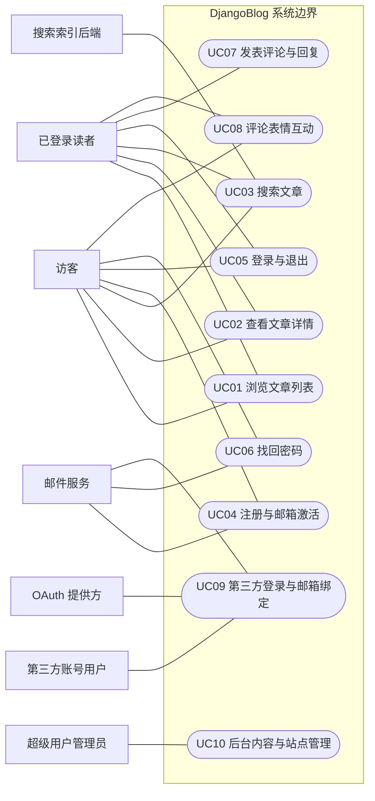

UC08 的访客关联只表示读取公开统计；写入要求登录。UC05 的登录主体是已有本站账号的用户，图中访客表示其尚未建立当前会话。UC06 的主体还须能够访问注册邮箱。

## 3. 用例清单

| 编号 | 用例 | 首要目标 |
|---|---|---|
| UC01 | 浏览文章列表 | 从首页、分类、标签、作者及归档入口发现内容，并按需翻页。 |
| UC02 | 查看文章详情 | 阅读文章正文、相邻文章和公开评论，并浏览评论分页。 |
| UC03 | 搜索文章 | 按关键字检索文章，查看摘要、高亮及可用的建议词。 |
| UC04 | 注册与邮箱激活 | 创建本站账号，通过邮箱链接激活后获得登录资格。 |
| UC05 | 登录与退出 | 使用账号密码建立登录会话，或退出以结束会话。 |
| UC06 | 找回密码 | 凭注册邮箱接收验证码并设置新密码。 |
| UC07 | 发表评论与回复 | 在文章下发表内容或回复已有评论，并按站点审核配置公开。 |
| UC08 | 评论表情互动 | 查看评论表情数量，并对公开评论增加或取消某种表情。 |
| UC09 | 第三方登录与邮箱绑定 | 以启用的第三方身份登录本站，必要时补充并验证邮箱以建立本地用户关联。 |
| UC10 | 后台内容与站点管理 | 维护文章及分类标签、启用或禁用评论，并调整站点与第三方登录配置。 |

## 4. 完整用例说明与逐例顺序图

顺序图使用“参与者 / 边界 / 控制 / 实体 / 外部系统”标记对象职责。实线箭头为调用或请求，虚线为返回；图是分析对象协作模型，不将每条箭头等同于单个实际 Python 函数。每图选定一个完整场景，其余支路在文字中说明。UC04 直接展示已发现的注册跳转缺陷，不据此声称成功通过端到端验证。

### UC01 浏览文章列表

| 项目 | 说明 |
|---|---|
| 参与者 | 访客；已登录读者 |
| 目标 | 从首页、分类、标签、作者及归档入口发现内容，并按需翻页。 |
| 触发 | 读者进入首页或点击分类、标签、作者、归档和页码链接。 |

**前置条件**

- Web 应用和数据库可访问；分类或标签入口需有对应对象。
- 分页大小由 PAGINATE_BY 决定，归档不分页。

**主流程**

1. 读者请求列表入口并携带可选页码或筛选参数。
2. URLConf 分派至 IndexView、CategoryDetailView、TagDetailView、AuthorDetailView 或 ArchivesView。
3. 视图解析页码，分类/标签按 slug 查找目标对象，生成缓存键。
4. 命中列表缓存时复用结果；否则经 ORM 读取文章并预加载作者、分类及标签，写入缓存。
5. 首页、作者、标签筛选 type='a' 且 status='p'；分类筛选当前及子分类的已发布记录；归档筛选已发布记录。
6. Django ListView 处理分页并构造上下文，模板生成文章摘要、分类标签和页码链接。
7. 读者选择下一页继续浏览，或选择文章转入 UC02。

**备选与异常**

- 分类或标签 slug 不存在：get_object_or_404 返回 404。
- 列表无文章：渲染空列表提示；缓存判断使用 if value，空结果不保证被视为命中。
- 非法或越界分页：最终由 Django ListView/Paginator 处理，不能把 PageNumberMixin 的缓存键转换理解为统一容错。
- 归档使用独立模板且不分页，路由另加一小时页面缓存；友情链接入口只列出 is_enable=True 的链接。

**后置条件**

- 返回列表或错误页面，阅读动作不改变文章正文和发布状态。
- 缓存未命中时可新增列表缓存，归档可新增页面缓存。

**源码对应**

- `src/DjangoBlog/blog/urls.py：列表、分类、作者、标签和归档路由`
- `src/DjangoBlog/blog/views.py：ArticleListView；IndexView；CategoryDetailView；AuthorDetailView；TagDetailView；ArchivesView`
- `src/DjangoBlog/djangoblog/mixins.py：SlugCachedMixin；OptimizedArticleQueryMixin；CachedListViewMixin；PageNumberMixin`
- `src/DjangoBlog/blog/models.py：Article；src/DjangoBlog/templates/blog/article_index.html；src/DjangoBlog/templates/blog/article_archives.html`
- `src/DjangoBlog/templates/blog/tags/article_pagination.html`

**顺序图**

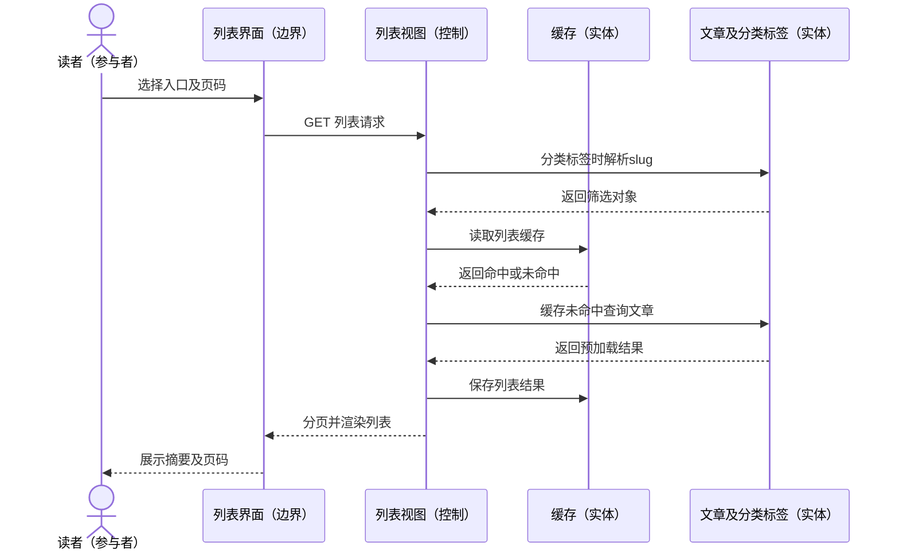

**实现边界与分析结论**

- 该用例是多个内容发现入口的归并，不表示它们使用完全相同的过滤条件。分类和归档未额外限制 type。
- 缓存是实现支持设施，不作为用例图中的人类参与者。分析基于静态源码，没有宣称线上性能指标。
- 顺序图选择分类/标签入口且列表缓存未命中的场景；缓存命中分支仅见文字说明。

### UC02 查看文章详情

| 项目 | 说明 |
|---|---|
| 参与者 | 访客；已登录读者 |
| 目标 | 阅读文章正文、相邻文章和公开评论，并浏览评论分页。 |
| 触发 | 读者打开文章永久链接或点击评论翻页链接。 |

**前置条件**

- 目标 article_id 存在，数据库与模板可用。
- 评论区是否显示由文章 comment_status 和全站 open_site_comment 共同决定。

**主流程**

1. 读者提交包含日期及 article_id 的详情请求。
2. ArticleDetailView 按主键获取 Article 对象。
3. 视图查询当前文章 is_enable=True、parent_comment=None 的父评论并预取子评论作者，同时读取 Article.comment_list() 的公开评论集合。
4. 依据 article_comment_count 对父评论分页；非数字、过小、过大的 comment_page 被归一到有效范围。
5. 读取站点配置、相邻已发布文章，计算 SEO 标题、摘要和关键字。
6. 执行 ARTICLE_DETAIL_LOAD 和 after_article_body_get 动作钩子，允许插件扩展上下文。
7. 模板渲染 Markdown 正文、目录及标签；满足文章和全站评论开关时显示递归评论、评论翻页及登录/评论入口。

**备选与异常**

- 文章不存在：返回 404。
- 评论关闭：正文仍显示，评论列表和表单由模板隐藏。
- 尚无公开评论：显示空评论状态；需审核的新评论在启用前不进入公开集合。
- 读者点击下一篇/上一篇时重新进入本用例；提交评论转 UC07，表情互动转 UC08。

**后置条件**

- 返回详情页面或 404，不修改文章内容。
- 文章评论集合或相邻文章查询可能使用缓存；插件回调可产生其自身定义的附加作用。

**源码对应**

- `src/DjangoBlog/blog/urls.py：detailbyid`
- `src/DjangoBlog/blog/views.py：ArticleDetailView`
- `src/DjangoBlog/blog/models.py：get_absolute_url；comment_list；next_article；prev_article`
- `src/DjangoBlog/templates/blog/article_detail.html`
- `src/DjangoBlog/templates/comments/tags/comment_list_modern.html；src/DjangoBlog/templates/comments/tags/comment_item_modern.html`
- `src/DjangoBlog/blog/templatetags/blog_tags.py：render_article_content 相关标签`

**顺序图**

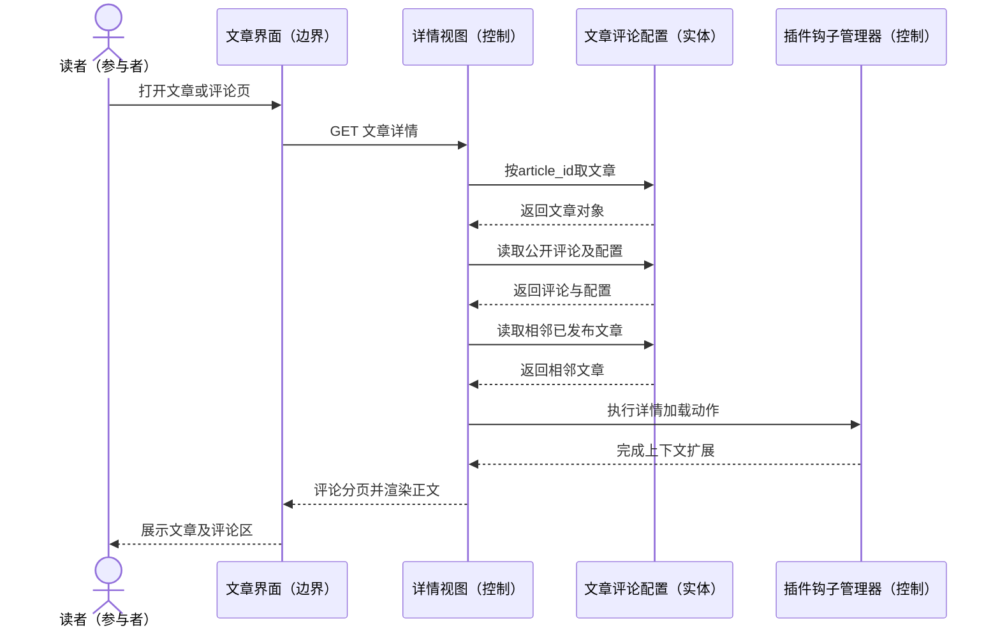

**实现边界与分析结论**

- 当前 ArticleDetailView 未覆盖 get_queryset，未显式限制 status='p'。不能声称草稿详情已受访问权限保护；这是待修复缺口。
- URL 中日期未在此视图中与对象创建日期核对，主键是实际检索条件。
- is_enable=True 表示允许公开，既可人工启用，也可因免审核配置直接启用，不能等同于人工审核通过。
- 源码定义 Article.viewed()，本用例视图未直接调用它；不把显示浏览量写成必然递增。

### UC03 搜索文章

| 项目 | 说明 |
|---|---|
| 参与者 | 访客；已登录读者；搜索索引后端 |
| 目标 | 按关键字检索文章，查看摘要、高亮及可用的建议词。 |
| 触发 | 读者提交搜索关键字或点击搜索结果分页。 |

**前置条件**

- 搜索索引已建立，配置的后端可访问。
- 未配置 ELASTICSEARCH_DSL 时使用本地 Whoosh；配置后使用自定义 Elasticsearch 后端。

**主流程**

1. 读者向 /search 提交 q、可选 page 和 is_suggest 参数。
2. 路由创建 EsSearchView 和 ElasticSearchModelSearchForm。
3. 视图为 SearchQuerySet 启用高亮；表单控制后端 is_suggest 标志并交给 Haystack 执行搜索。
4. 索引后端按配置检索。Elasticsearch 分支可先计算建议词，再匹配 title/body，并显式筛选 status='p'、type='a'。
5. Haystack 返回 SearchResult 集合及建议词，按页构建结果上下文；模板访问 result.object 解析对应 Article。
6. 模板显示结果摘要、查询词和页码；有建议词时允许以 is_suggest=no 坚持原词。
7. 读者选择文章转入 UC02。

**备选与异常**

- 空关键字或无结果：返回搜索页无结果提示。
- 建议词不可用：以原查询词继续；Whoosh 和 Elasticsearch 的建议能力不能视为相同。
- 后端未配置完整、索引缺失或网络失败：可能触发后端异常；源码没有统一的无索引回退流程。
- 索引重建时 ArticleIndex.index_queryset 仅筛 status='p'，没有按 type 区分；实时更新及两种后端的可见性需分别核验。

**后置条件**

- 返回搜索结果或失败响应，不修改文章正文。
- 读者可通过结果链接继续阅读。

**源码对应**

- `src/DjangoBlog/djangoblog/urls.py：search_view_factory 与 search 路由`
- `src/DjangoBlog/blog/views.py：EsSearchView`
- `src/DjangoBlog/djangoblog/elasticsearch_backend.py：search；ElasticSearchModelSearchForm`
- `src/DjangoBlog/djangoblog/settings.py：HAYSTACK_CONNECTIONS 后端选择；RealtimeSignalProcessor`
- `src/DjangoBlog/blog/search_indexes.py：ArticleIndex`
- `src/DjangoBlog/templates/search/search.html；src/DjangoBlog/templates/search/indexes/blog/article_text.txt`

**顺序图**

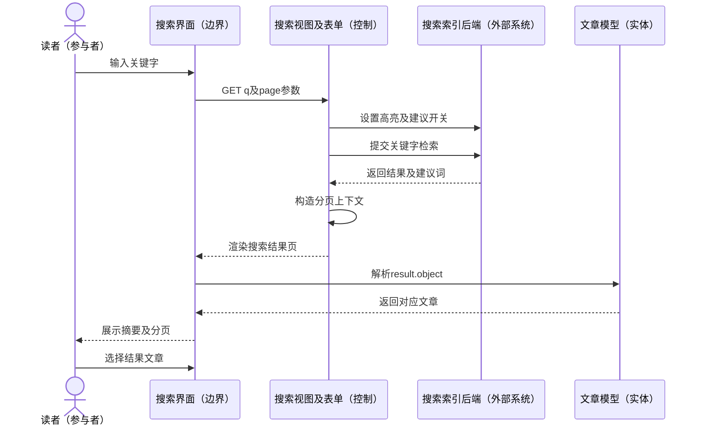

**实现边界与分析结论**

- 搜索索引后端用一个分析对象概括 Whoosh 或 Elasticsearch，图不要求两者同时部署。
- Elasticsearch 的 p+a 过滤不能推广为所有后端和实时索引的统一保证。
- 这是源码调用链分析，未做真实 Elasticsearch/Whoosh 部署或搜索质量联调。

### UC04 注册与邮箱激活

| 项目 | 说明 |
|---|---|
| 参与者 | 访客；邮件服务 |
| 目标 | 创建本站账号，通过邮箱链接激活后获得登录资格。 |
| 触发 | 访客提交注册表单，随后打开验证邮件链接。 |

**前置条件**

- 注册页面可访问，用户名和邮箱未被现有账号占用。
- 邮件配置可用；激活链接依赖 SECRET_KEY 和用户 ID 生成签名。

**主流程**

1. 访客提交用户名、邮箱及两次密码，带上 CSRF 令牌。
2. RegisterForm 复用 UserCreationForm 校验用户名、密码和确认密码，并检查邮箱重复。
3. RegisterView 构建用户，设 is_active=False、source='Register' 后保存。
4. 视图生成邮箱验证签名和 URL，经 send_email 信号调用邮件发送处理器。
5. 设计意图是转向注册成功说明页；当前代码的 accounts:result 命名空间不匹配，应作为实际中断点记录。
6. 用户收到邮件后请求 account_result，参数 type=validation、id、sign。
7. account_result 验证签名，通过后设 is_active=True 并保存，渲染验证成功页；用户再进入 UC05 登录。

**备选与异常**

- 用户名或邮箱重复、密码不符合规则或两次不一致：返回带错误的注册表单。
- 激活用户 ID 不存在：404；签名错误：403；用户已经激活：重定向首页。
- 当前 RegisterView 构建 register 结果跳转时 reverse('accounts:result') 与项目 namespace='account' 不匹配，可在用户保存及发送信号之后触发 NoReverseMatch。
- 邮件发送处理器捕获发送异常并保存失败日志，注册视图不核验送达；不得把发送信号成功等同于邮件已收到。

**后置条件**

- 校验通过并执行保存后，账号可能已存在但处于未激活状态，即使后续结果页跳转失败。
- 只有正确激活请求执行成功后用户才变为激活状态。

**源码对应**

- `src/DjangoBlog/accounts/urls.py：register 与 result`
- `src/DjangoBlog/accounts/forms.py：RegisterForm；clean_email`
- `src/DjangoBlog/accounts/views.py：RegisterView；account_result`
- `src/DjangoBlog/djangoblog/urls.py：include(accounts.urls, namespace='account')`
- `src/DjangoBlog/djangoblog/utils.py：send_email；src/DjangoBlog/djangoblog/blog_signals.py：邮件发送处理器`
- `src/DjangoBlog/templates/account/registration_form.html；src/DjangoBlog/templates/account/result.html`

**顺序图**

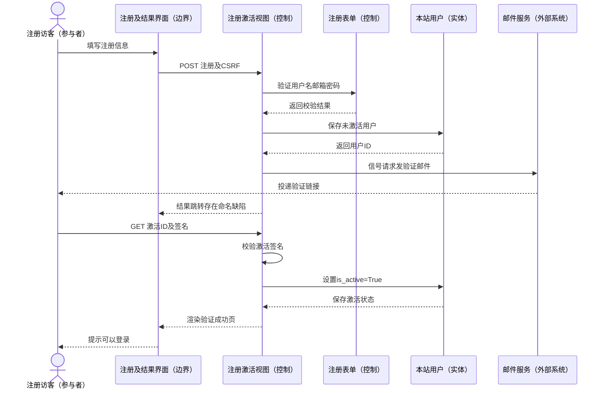

**实现边界与分析结论**

- 本图显示现存代码意图与激活支路，并将注册结果跳转缺陷直接标出，不代表端到端注册已成功实测。
- 激活签名由 SECRET_KEY 与 ID 确定，当前实现未见独立过期时间或一次性随机令牌。

### UC05 登录与退出

| 项目 | 说明 |
|---|---|
| 参与者 | 本站用户 |
| 目标 | 使用账号密码建立登录会话，或退出以结束会话。 |
| 触发 | 用户提交登录表单，或在已登录状态点击退出。 |

**前置条件**

- 登录分支要求已有可用账号，默认认证需账号处于激活状态。
- 浏览器允许本站会话 Cookie；退出分支针对当前会话。

**主流程**

1. 用户打开 /login/，可携带 next 目标地址。
2. 提交用户名、密码、remember 及 next，LoginForm 通过 Django AuthenticationForm 完成认证。
3. LoginView 复用已校验表单的用户缓存，清理侧边栏缓存并执行 auth.login。
4. 根据 remember 设置会话过期时间；未勾选使用 SESSION_COOKIE_AGE，勾选使用 REMEMBER_ME_LOGIN_TTL。
5. 校验 next 是否属于当前主机，非法或为空则使用首页；设置 logged_user=true 标记 Cookie 后重定向。
6. 用户选择退出，LogoutView.get 执行 logout 并清理侧边栏缓存。
7. 退出响应删除 logged_user Cookie，并重定向 /login/。

**备选与异常**

- 账号不存在、密码错误或账号未激活：表单报错，不建立登录会话。
- CSRF 校验失败：请求被拒绝。
- next 指向外站：使用 success_url='/'，不跳转外站。
- 用户也可转 UC06 找回密码，或转 UC09 使用启用的第三方渠道。

**后置条件**

- 登录成功：Django Session 保存认证状态，并设置供前端识别的 logged_user 标记。
- 退出成功：当前会话的认证状态被清除，登录标记 Cookie 被删除。

**源码对应**

- `src/DjangoBlog/accounts/urls.py：login 与 logout`
- `src/DjangoBlog/accounts/views.py：LogoutView；LoginView`
- `src/DjangoBlog/accounts/forms.py：LoginForm(AuthenticationForm)`
- `src/DjangoBlog/djangoblog/base_views.py：LoginFormView、LogoutRedirectView`
- `src/DjangoBlog/templates/account/login.html`
- `src/DjangoBlog/djangoblog/blog_signals.py：user_auth_callback`

**顺序图**

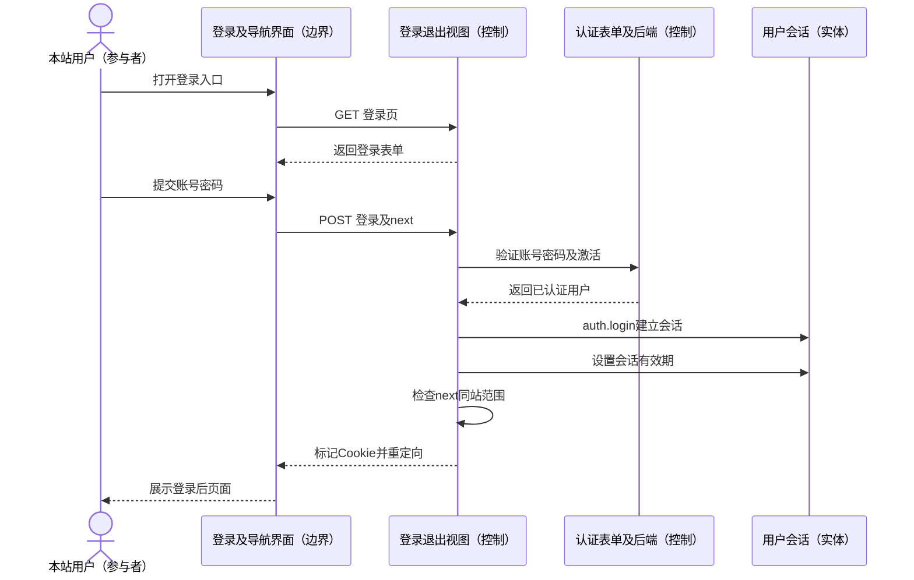

**实现边界与分析结论**

- logged_user 是前端标记而非认证凭证，后端是否登录以 Django request.user/Session 为准。
- 退出在当前源码中由 GET 执行；本分析忠实描述，未自行修改接口方法。
- 顺序图选择账号密码登录成功场景；退出是独立触发的备选场景：GET logout→清除会话→删除标记Cookie→重定向登录页。

### UC06 找回密码

| 项目 | 说明 |
|---|---|
| 参与者 | 遗忘密码的用户；邮件服务 |
| 目标 | 凭注册邮箱接收验证码并设置新密码。 |
| 触发 | 用户在找回密码页获取验证码并提交新密码。 |

**前置条件**

- 用户能够访问注册邮箱，缓存和邮件配置可用。
- 重设表单最终要求邮箱已注册，验证码与缓存记录一致。

**主流程**

1. 用户输入邮箱，页面向 forget_password_code 发送 POST。
2. ForgetPasswordCodeForm 验证邮箱格式，视图生成六位验证码。
3. 视图请求发送验证邮件，并用邮箱为键将验证码缓存 300 秒。
4. 用户从邮件读取验证码，提交邮箱、验证码及两次新密码。
5. ForgetPasswordForm 校验新密码规则、两次一致、邮箱存在，并由 utils.verify 比较缓存验证码。
6. ForgetPasswordView 查得 BlogUser，使用 make_password 加密后保存密码。
7. 系统重定向 /login/，用户以新密码重新登录。

**备选与异常**

- 获取验证码时邮箱格式非法：返回“错误的邮箱”；该接口未检查邮箱是否已注册。
- 邮箱不存在、新密码不一致或不合规则：重显表单错误。
- 验证码不符或缓存过期：返回 Verification code error。
- 邮件发送失败：处理器写失败日志，视图仍可能返回 ok；前端重发倒计时不能作为服务端限流证据。

**后置条件**

- 全部校验成功后数据库只保存密码哈希，随后返回登录入口。
- 当前代码未见重设成功后删除验证码的步骤；其仍可能在缓存 TTL 内存在。

**源码对应**

- `src/DjangoBlog/accounts/urls.py：forget_password、forget_password_code`
- `src/DjangoBlog/accounts/views.py：ForgetPasswordView；ForgetPasswordEmailCode`
- `src/DjangoBlog/accounts/forms.py：ForgetPasswordForm；ForgetPasswordCodeForm`
- `src/DjangoBlog/accounts/utils.py：send_verify_email；verify；set_code`
- `src/DjangoBlog/templates/account/forget_password.html`
- `src/DjangoBlog/djangoblog/blog_signals.py：send_email_signal_handler`

**顺序图**

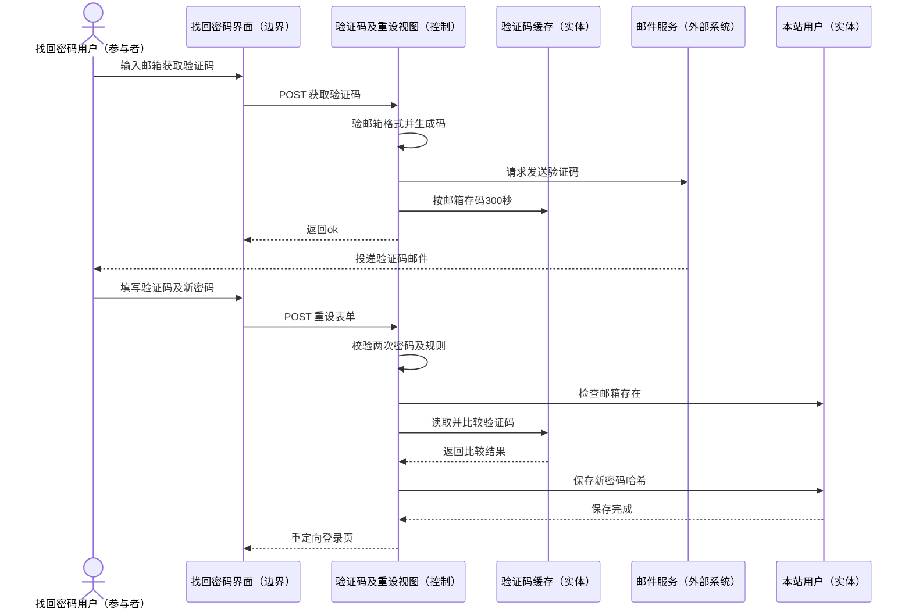

**实现边界与分析结论**

- 主流程把表单验证归入控制对象；实际密码复杂度验证来自 Django password_validation。
- 验证码发送接口未见服务端频率限制，重设成功未显式消费验证码；这是实现不足而非已经完成的安全能力。
- 未执行真实邮件投递与密码重设联调。
- 顺序图选择邮件实际投递、验证码有效且密码合规则的主场景；邮件送达是外部条件，未做联调。

### UC07 发表评论与回复

| 项目 | 说明 |
|---|---|
| 参与者 | 已登录读者；管理员（审核支路） |
| 目标 | 在文章下发表内容或回复已有评论，并按站点审核配置公开。 |
| 触发 | 用户提交顶层评论，或选择回复后提交内容。 |

**前置条件**

- 用户已登录，目标文章存在且 comment_status!='c'。
- 常规界面入口还要求全站 open_site_comment=True；POST 后端没有重复检查该全站开关。

**主流程**

1. 用户填写正文；回复时前端将 parent_comment_id 与回复正文写入原评论表单。
2. 浏览器或 HTMX 提交至 article/<article_id>/postcomment，带上 CSRF 令牌。
3. AuthenticatedFormView 检查登录与 CSRF；CommentForm 校验 body 和可选父评论整数 ID。
4. CommentPostView 读取当前用户、文章及 BlogSettings，检查文章评论是否关闭。
5. 构建 Comment，关联 article 与 author；有父 ID 时取得对应 Comment 并建立 parent_comment 关系。
6. comment_need_review=False 时直接设 is_enable=True；否则保留默认 False。
7. 保存评论并重定向文章的 div-comment-ID 锚点；公开评论保存会触发缓存清理和评论邮件通知支路。
8. 需审核时由管理员在 UC10 启用评论，随后才进入公开评论集合。

**备选与异常**

- 未登录：login_required 重定向登录页；CSRF 失败：拒绝请求。
- 正文为空或超过模型/表单允许长度：form_invalid 返回文章模板和错误。
- 文章不存在：404；评论关闭：当前代码抛 ValidationError，未见友好表单错误封装。
- 父评论不存在：直接 Comment.objects.get 会抛 DoesNotExist；父 ID 未检查是否属于同一文章或是否公开。
- 待审核评论已保存但公开列表不显示，重定向锚点可能尚不存在。

**后置条件**

- 成功后新增 Comment，持有作者、文章及可空父评论引用。
- 评论是否公开取决于 is_enable；需审核时保存完成不代表公开完成。

**源码对应**

- `src/DjangoBlog/comments/urls.py：postcomment`
- `src/DjangoBlog/comments/views.py：CommentPostView`
- `src/DjangoBlog/comments/forms.py：CommentForm；src/DjangoBlog/comments/models.py：Comment`
- `src/DjangoBlog/djangoblog/base_views.py：AuthenticatedFormView`
- `src/DjangoBlog/templates/comments/tags/post_comment_modern.html；src/DjangoBlog/templates/comments/tags/comment_item_modern.html`
- `src/DjangoBlog/frontend/src/components/commentSystem.js：submitReply；src/DjangoBlog/djangoblog/blog_signals.py：model_post_save_callback`

**顺序图**

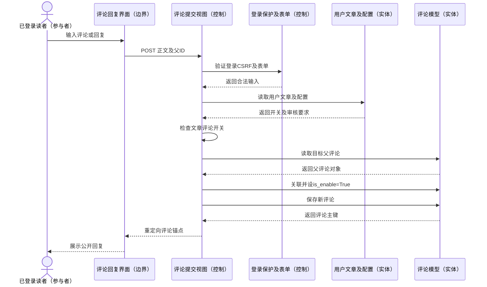

**实现边界与分析结论**

- 父评论同文章校验、全站评论关闭的后端强制校验及异常友好处理属于待改进项。
- frontend commentSystem.js 中 /api/comments/ 的通用示例并无对应路由；当前页面主要使用 Django/HTMX 表单，不能把示例接口当成已实现 API。
- is_enable=False 同时可能表示待审核或禁用，当前模型未区分审核状态枚举。
- 顺序图选择已登录、父评论存在且免审核的回复成功场景；顶层评论不读取父评论，需审核时不立即公开。

### UC08 评论表情互动

| 项目 | 说明 |
|---|---|
| 参与者 | 访客（读取统计）；已登录读者（切换表情） |
| 目标 | 查看评论表情数量，并对公开评论增加或取消某种表情。 |
| 触发 | 页面初始化表情组件，或读者选择已有/新增表情。 |

**前置条件**

- 评论存在且 is_enable=True。
- 写入分支要求登录、合法 reaction_type 和有效 CSRF 令牌。

**主流程**

1. 模板通过 get_reactions_for_user 为评论提供 SSR 初始统计。reactionPicker 优先读取 data-reactions。
2. SSR 数据缺失或解析失败时，组件 GET /comment/<id>/react 获取公开统计。
3. 读者点击一种表情；前端检查登录，随后 POST reaction_type 和 CSRF。
4. CommentReactionView 再次检查 request.user.is_authenticated，只读取已启用评论，并验证表情是否属于八种允许值。
5. 通过 get_or_create 按 comment、user、reaction_type 查建记录。新建表示 added；已存在则删除，表示 removed。
6. 调用 get_reactions_summary，统计各表情数量、当前用户是否选择及最多十个用户昵称/用户名。
7. 返回 JSON 的 action 和 reactions，前端刷新本地统计并关闭选择器。

**备选与异常**

- 访客可 GET；尝试 POST 时服务端返回 401，前端提示重新登录。
- 非法表情类型：返回 400；评论不存在或未启用：404。
- 缺少或无效 CSRF：中间件拒绝；前端获取不到令牌时直接提示刷新。
- API 读取失败：组件记录错误并使用空统计；切换失败则提示重试。

**后置条件**

- 成功切换后，该用户该评论该表情记录在存在与不存在之间切换。
- 唯一约束为 (comment,user,reaction_type)，同一用户可对同一评论选不同表情。

**源码对应**

- `src/DjangoBlog/comments/urls.py：comment_react`
- `src/DjangoBlog/comments/views.py：CommentReactionView`
- `src/DjangoBlog/comments/models.py：get_reactions_summary；CommentReaction`
- `src/DjangoBlog/frontend/src/components/reactionPicker.js：init、loadFromAPI、toggleReaction`
- `src/DjangoBlog/templates/comments/tags/comment_item_modern.html`
- `src/DjangoBlog/blog/templatetags/blog_tags.py：get_reactions_for_user`

**顺序图**

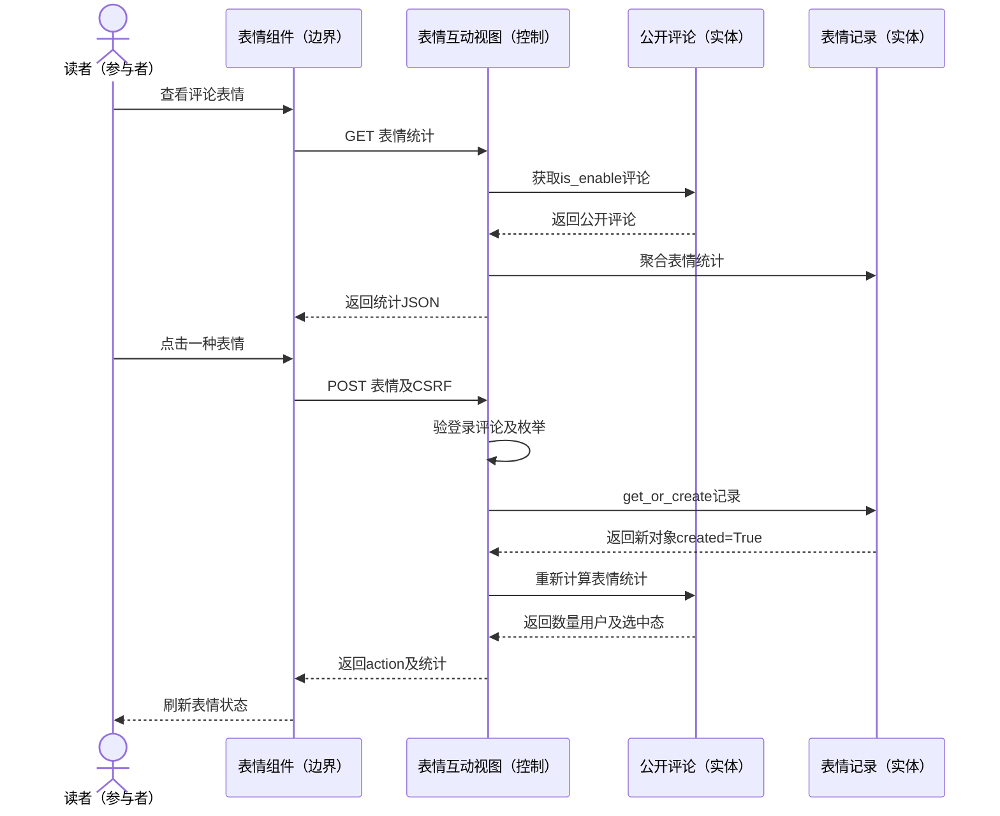

**实现边界与分析结论**

- 并非每次页面加载都会调用 GET 接口，正常分支优先使用 SSR 数据。
- 表情枚举约束由视图校验，unique_together 约束防止同一三元组重复；不能称为每位用户只能选择一种表情。
- get_reactions_summary 的用户名最多十个，统计数量不因该列表截断而截断。
- 顺序图选择无SSR数据、先GET统计再新增表情的成功场景；取消表情时get_or_create返回已有对象，视图删除后重新统计。

### UC09 第三方登录与邮箱绑定

| 项目 | 说明 |
|---|---|
| 参与者 | 第三方账号用户；OAuth 提供方；邮件服务（补绑支路） |
| 目标 | 以启用的第三方身份登录本站，必要时补充并验证邮箱以建立本地用户关联。 |
| 触发 | 用户点击第三方登录入口，提供方随后回调授权码。 |

**前置条件**

- 对应 OAuthConfig 已启用并具备有效 appkey、appsecret 和 callback_url。
- 第三方服务及回调网络可达；缺邮箱时还需要邮件配置。

**主流程**

1. 用户访问 oauth/oauthlogin，提交 type 和 next_url。
2. oauthlogin 按启用配置取得管理器，并限制 next_url 的站内目标，重定向提供方授权地址。
3. 用户在第三方完成授权后，提供方向 oauth/authorize 回调 code 和 type。
4. 管理器用 code 获取 token，再请求用户信息；视图按 type+openid 查找已有 OAuthUser 并更新资料。
5. 存在邮箱时，在事务中复用 author 或按邮箱 get_or_create 本地用户，关联并保存 OAuthUser。
6. 视图发出 oauth_user_login_signal，执行 login、设置会话期限和 logged_user Cookie，重定向安全目标。
7. 若第三方未返回邮箱，先保存 OAuthUser，再进入 RequireEmailView；用户补填邮箱，系统保存并发送确认链接。
8. 用户打开 emailconfirm，签名通过后在事务中关联或创建本地用户，建立登录会话并返回绑定成功页。

**备选与异常**

- 缺少 type 或未启用渠道：重定向首页。
- 换 token 抛 OAuthAccessTokenException：重定向首页；其他失败可能重新发起授权；未返回用户资料则返回目标页。
- 补邮箱表单错误：重新显示表单；OAuthUser 不存在：404；邮箱确认签名错误：403。
- 非法 next_url：回退首页。
- 补绑涉及邮件送达，源码不保证外部提供方当前接口及凭据可用。

**后置条件**

- 主分支成功后保存外部身份与本地 BlogUser 关联并建立会话。
- 缺邮箱且尚未确认时可仅有未绑定的 OAuthUser；收到确认链接并不等于完成绑定。

**源码对应**

- `src/DjangoBlog/oauth/urls.py：oauthlogin、authorize、require_email、email_confirm、bindsuccess`
- `src/DjangoBlog/oauth/views.py：get_redirecturl；oauthlogin；authorize；emailconfirm；RequireEmailView`
- `src/DjangoBlog/oauth/forms.py：RequireEmailForm；src/DjangoBlog/oauth/models.py：OAuthUser、OAuthConfig`
- `src/DjangoBlog/oauth/oauthmanager.py：get_oauth_apps；get_manager_by_type；各提供方管理器`
- `src/DjangoBlog/templates/oauth/oauth_applications.html；src/DjangoBlog/templates/oauth/require_email.html；src/DjangoBlog/templates/oauth/bindsuccess.html`
- `src/DjangoBlog/djangoblog/blog_signals.py：oauth_user_login_signal_handler`

**顺序图**

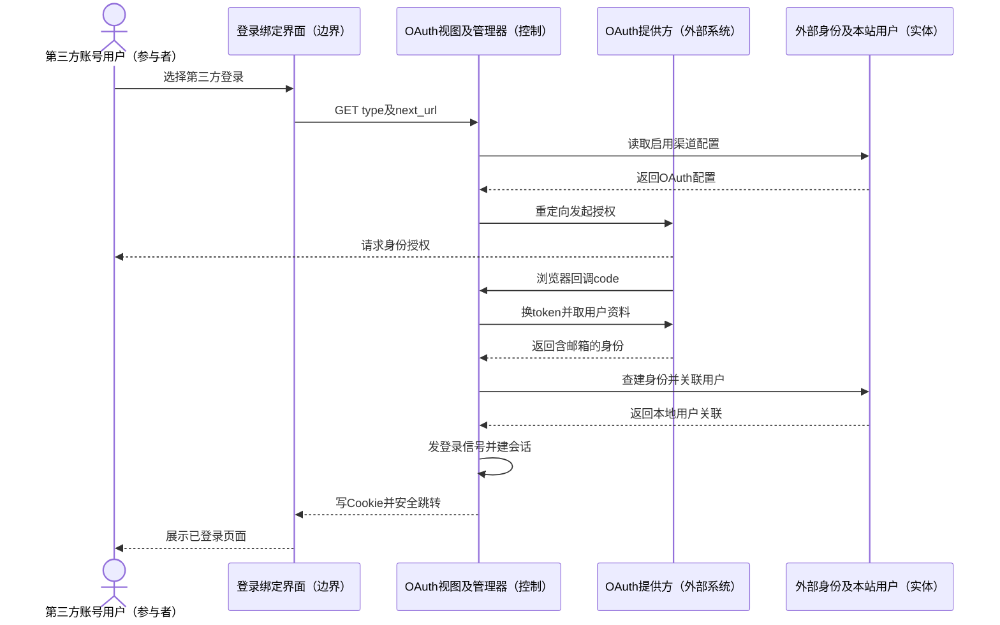

**实现边界与分析结论**

- 顺序图选择第三方返回邮箱的成功场景；提供方授权页交互合并为外部对象，回调实际经用户浏览器传递。缺邮箱支路由文字说明完整描述。
- 当前绑定表未声明 (type,openid) 数据库联合唯一约束；邮箱确认签名未含邮箱和过期时间。
- RequireEmailView 提交的 oauthid 来自隐藏字段，源码未见与授权会话的严格绑定校验；不能声称完整防重放与防越权已实现。
- 源码按提供方邮箱关联本地用户，没有额外确认提供方邮件验证状态；外部身份可信度需单独审查。
- 未执行真实第三方登录、授权凭据配置或邮件绑定联调。

### UC10 后台内容与站点管理

| 项目 | 说明 |
|---|---|
| 参与者 | 超级用户管理员 |
| 目标 | 维护文章及分类标签、启用或禁用评论，并调整站点与第三方登录配置。 |
| 触发 | 管理员访问 /admin/ 并选择内容、评论或配置管理页面。 |

**前置条件**

- 管理员已完成 Django 后台认证。
- 自定义 DjangoBlogAdminSite.has_permission 要求 request.user.is_superuser，不能只依据 is_staff。

**主流程**

1. 管理员请求自定义 /admin/ 站点，站点检查超级用户资格。
2. 管理员进入已注册模型列表，按搜索、筛选或编辑入口选择文章、分类、标签、链接、侧边栏、评论、用户、OAuth 配置或站点配置。
3. 编辑文章时 Django ModelForm 校验标题等字段，保存文章、作者、分类及标签；也可批量发布、转草稿或开关文章评论。
4. 管理评论时修改 is_enable，或使用启用/禁用批量动作，以控制公开展示。
5. 编辑 BlogSettings 时已有记录直接跳转编辑页；禁止删除，已有配置时禁止新增，模型 clean 再检查单例。
6. 保存站点设置触发模型和 Admin 中的缓存清理，页面提示设置已保存；文章普通保存由信号执行部分缓存失效和其他附加处理。
7. 后台反馈保存结果，后续前台请求按保存后的数据和缓存状态展示。

**备选与异常**

- 无超级用户资格：不能进入该自定义站点；普通 staff 不构成本实现的充分权限条件。
- 表单字段或模型校验失败：保留输入并展示错误。
- 文章/评论批量操作使用 queryset.update，绕过实例 save 和 post_save，不能保证同样的缓存清理或搜索更新。
- OAuthUser 在后台只读且禁止手工新增；OAuthConfig 可以配置渠道。
- CommentReaction 只在默认 admin.site 注册，而实际 /admin/ 使用另一个 admin_site，不能把表情记录管理算作该入口已接通能力。

**后置条件**

- 成功保存后相关内容或配置进入数据库；评论公开性和文章发布性按更新字段变化。
- BlogSettings 普通保存后缓存被清理；批量更新后的缓存与索引一致性仍需验证。

**源码对应**

- `src/DjangoBlog/djangoblog/urls.py：/admin/ 使用 admin_site.urls`
- `src/DjangoBlog/djangoblog/admin_site.py：DjangoBlogAdminSite；has_permission；模型注册清单`
- `src/DjangoBlog/blog/admin.py：文章动作；ArticlelAdmin；BlogSettingsAdmin`
- `src/DjangoBlog/comments/admin.py：disable_commentstatus；enable_commentstatus；CommentAdmin`
- `src/DjangoBlog/oauth/admin.py：OAuthUserAdmin、OAuthConfigAdmin；src/DjangoBlog/accounts/admin.py：BlogUserAdmin`
- `src/DjangoBlog/blog/models.py：BlogSettings；clean；save；src/DjangoBlog/djangoblog/blog_signals.py：model_post_save_callback`

**顺序图**

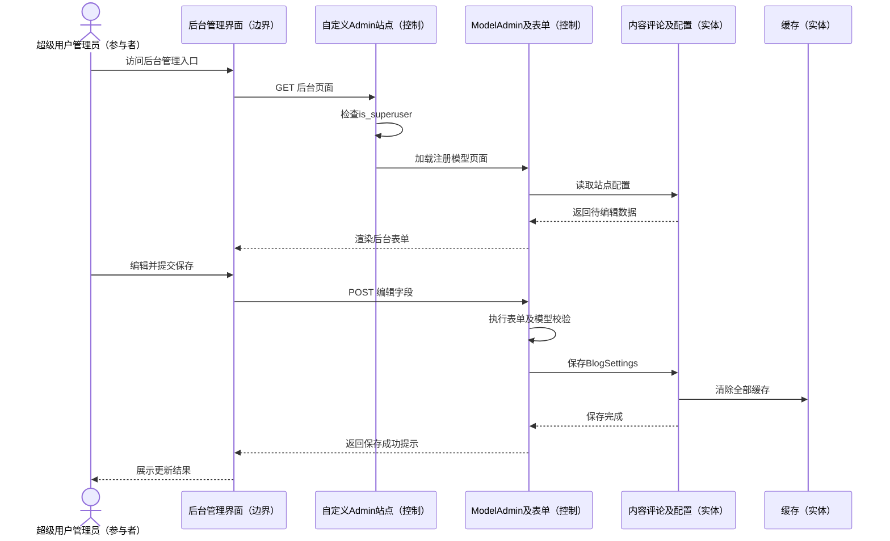

**实现边界与分析结论**

- 后台作为一个管理用例归并多个 ModelAdmin；顺序图表现普通保存，批量动作的差异在备选流程明确。
- 配置单例由后台和 clean 校验实现，不等价于数据库单例约束。
- 管理员权限检查实现只返回 is_superuser；更细的模型权限仍由 Django Admin 处理。
- 本周侧重分析模型，不把后台保存、外部索引与缓存同步描述成已经通过真实集成验证。
- 顺序图选择已有站点配置的普通编辑保存场景；文章编辑、评论审核及批量操作详见主/备选流程，具有不同缓存副作用。

## 5. 跨用例一致性与实现缺口

| 编号 | 涉及用例 | 源码中可见的现状 | 影响及建议 |
|---|---|---|---|
| G01 | UC01、UC02 | 列表通常筛已发布内容；详情仅按主键读取 | 统一详情访问策略，避免公开页面直接读取草稿 |
| G02 | UC04 | 注册跳转使用 accounts:result，项目 namespace 为 account | 保存/发信后可能抛 NoReverseMatch；修正反向解析并验证 |
| G03 | UC07 | 父评论仅按主键取得，未检查所属文章 | 拒绝跨文章回复及不存在的父 ID，返回可理解错误 |
| G04 | UC07 | 全站关闭仅模板隐藏入口，POST 只检查文章开关 | 提交视图检查全站开关，统一界面与后端约束 |
| G05 | UC06 | 码缓存五分钟；未见后端发送限流与成功消费 | 加发送频率、尝试次数和成功删除，保留必要审计 |
| G06 | UC09 | 外部身份未设联合唯一；补绑 ID 来自隐藏字段 | 绑定授权会话并校验归属，令牌应含目标邮箱与有效期 |
| G07 | UC10 | 批量动作使用 queryset.update | 不能依赖 save 信号同步缓存与索引；统一失效机制 |
| G08 | UC03 | 两类搜索后端过滤与建议策略不同 | 分后端验证可见性、索引同步和分页准确性 |
| G09 | UC04、UC06、UC09 | 邮件失败被记录，视图不保证最终送达 | 区分已请求发送与已投递，并提供可重试路径 |

## 6. 阅读范围与验证口径

已核对相关 URLConf、视图、表单、模型、模板和实际前端组件，区分 SSR 表情初始值与 API 降级、普通保存与批量更新、评论公开标志与人工审核。插件仅作为可扩展执行点，不推断所有插件必定启用。

RSS、站点地图、健康检查、图床上传、缓存清理和微信机器人等辅助入口属于整体架构边界的补充接口，未作为本轮 Web 主流程的独立用例。机器人天气/身份证处理返回“建设中”，前端示例 `/api/comments/` 未见对应路由，均不计为已完成业务能力。

本文不包含虚构运行记录、外部账号联调结果或实际会议纪要。结论限于当前源码静态检查，需结合本周主报告的验证与后续计划核验。
